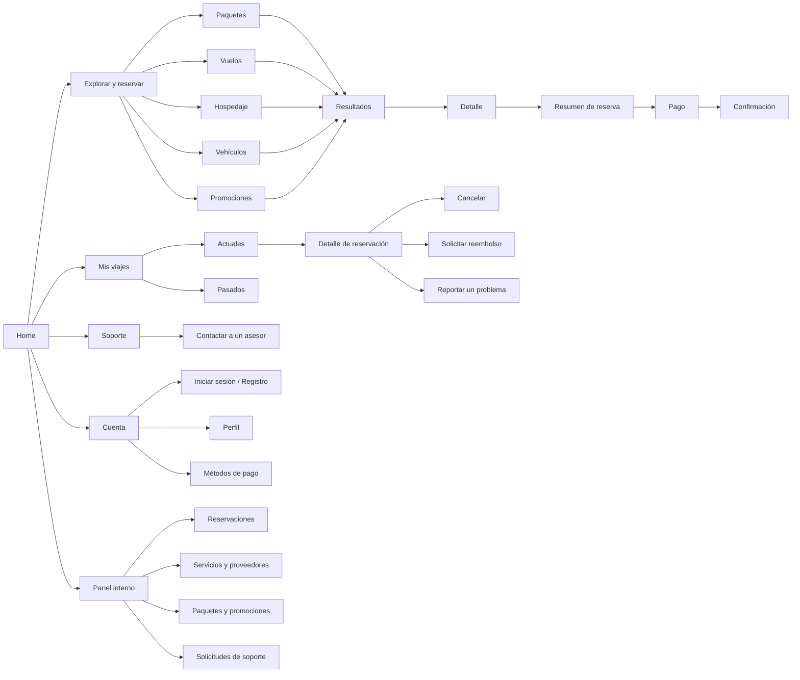
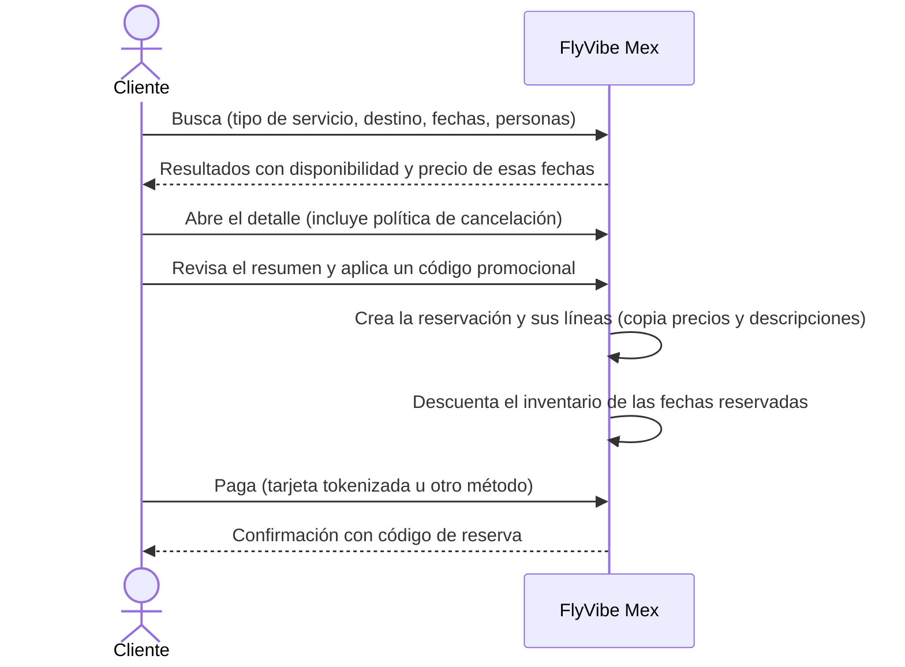

# 01 · Visión y reglas de negocio de FlyVibe Mex

> **Para quién es este documento:** todo el equipo. Explica *qué* construimos y *qué reglas* debe respetar cualquier pantalla o funcionalidad, antes de entrar al *cómo* (eso está en [02 · Guía de arquitectura](02_GUIA_ARQUITECTURA_MVC_Y_FRONTEND.md)).
>
> **Fuente:** documento de avance del Proyecto Integrador (`AVANCE2_EQUIPO1.pdf`) y auditoría técnica [`CONTEXTO_PROYECTO_FLYVIBEMEX.md`](../CONTEXTO_PROYECTO_FLYVIBEMEX.md).

## Índice
1. [Nombre y propósito](#1-nombre-y-propósito)
2. [Problemática y antecedentes](#2-problemática-y-antecedentes)
3. [Beneficiarios](#3-beneficiarios)
4. [Conclusiones del benchmarking](#4-conclusiones-del-benchmarking)
5. [Actores y roles](#5-actores-y-roles)
6. [Mapa de sitio](#6-mapa-de-sitio)
7. [Flujos principales](#7-flujos-principales)
8. [Reglas críticas del negocio (R1–R13)](#8-reglas-críticas-del-negocio-r1r13)
9. [Cronograma](#9-cronograma)

---

## 1. Nombre y propósito

**FlyVibe Mex** es fácil de pronunciar, leer, escribir y recordar, y evoca la experiencia de viaje y el mercado nacional.

**Objetivo:** desarrollar una aplicación web centralizada que permita **cotizar, reservar y gestionar** paquetes de viaje, vuelos, renta de vehículos y noches de hotel de forma integral y sencilla, con una arquitectura lo bastante flexible para ajustarse a mediano y largo plazo.

## 2. Problemática y antecedentes

Organizar un viaje completo es complejo porque los sistemas de reserva están **fragmentados**: el viajero invierte tiempo comparando precios y disponibilidad en varias plataformas independientes. FlyVibe Mex propone un **canal único** que integre la oferta turística local con inventario en tiempo real.

**Referentes:** Expedia y Despegar manejan las mismas variables operativas (vuelos, hospedaje y transporte) y sirven como base empírica para diseñar una arquitectura propia y una interfaz adaptada al mercado local.

## 3. Beneficiarios

| Tipo | Quién | Beneficio |
|---|---|---|
| Directo | **Clientes / viajeros** | Herramienta intuitiva y centralizada para autogestionar sus viajes |
| Directo | **Agentes de la agencia** | Menos tiempo en ventas y administración de reservas |
| Indirecto | **Proveedores** (hoteles, aerolíneas, rentadoras) | Más ventas y visibilidad al publicar su oferta en la plataforma |

## 4. Conclusiones del benchmarking

| Característica | Despegar | Expedia | Booking | **Decisión para FlyVibe Mex** |
|---|---|---|---|---|
| Navegación por servicios | Muy visible y categorizada | Modular y limpia | Centrada en hospedaje | Categorías claras: **Paquetes, Vuelos, Hospedaje y Vehículos**, sin saturar la cabecera |
| Buscador principal | Parametrizado y prominente | Centralizado y modular | Muy prominente | Buscador **simple** por tipo de servicio, destino y fechas |
| Promociones | Alta visibilidad | Menor protagonismo | Programa de beneficios | Sección de promociones **controlada**, sin dominar la pantalla |
| Gestión de viajes | Cuenta y servicios | "Mis viajes" muy visible | Desde la cuenta | **"Mis viajes"** con actuales, pasados, detalle, cancelación y soporte |
| Políticas y filtros | Ofertas y categorías | Filtros por servicio | Políticas muy visibles | Filtros relevantes y **política de cancelación visible antes de pagar** |
| En general | Referencia comercial | Referencia de organización | Referencia de flujo de reserva | Adoptar claridad y consistencia, **sin copiar** identidad visual ni funciones fuera del alcance |

Riesgo a evitar (visto en Despegar): saturación visual por exceso de banners y colores.

## 5. Actores y roles

| Actor | ¿Usa el sistema? | Qué hace |
|---|---|---|
| **Cliente / viajero** | Sí (rol CLIENTE) | Busca, reserva y paga; consulta "Mis viajes"; cancela, pide reembolsos y abre solicitudes de soporte |
| **Agente** | Sí (rol AGENTE) | Gestiona reservaciones, atiende solicitudes de soporte asignadas y registra cambios de estado |
| **Administrador** | Sí (rol ADMINISTRADOR) | Administra catálogo de servicios y proveedores, paquetes y promociones |
| **Proveedor** (aerolínea, hotel, rentadora, otro) | **No** inicia sesión | Es el origen de cada servicio del catálogo. FlyVibe Mex puede figurar como proveedor interno de los paquetes que arma |

## 6. Mapa de sitio



<details>
<summary>Versión en texto (por si tu visor no muestra Mermaid)</summary>

```
Home
├── Explorar y reservar
│   ├── Paquetes ──┐
│   ├── Vuelos ────┤
│   ├── Hospedaje ─┼──► Resultados ► Detalle ► Resumen de reserva ► Pago ► Confirmación
│   ├── Vehículos ─┤
│   └── Promociones┘
├── Mis viajes
│   ├── Actuales ──► Detalle de reservación ─┬─► Cancelar
│   └── Pasados                              ├─► Solicitar reembolso
│                                            └─► Reportar un problema
├── Soporte ──► Contactar a un asesor
├── Cuenta ──► Iniciar sesión / Registro · Perfil · Métodos de pago
└── Panel interno ──► Reservaciones · Servicios y proveedores · Paquetes y promociones · Solicitudes de soporte
```
</details>

> **Nota:** la sección **Tours** que hoy existe en la aplicación no forma parte de este mapa de sitio. Ver la decisión pendiente en [04 · Estándares y hoja de ruta](04_ESTANDARES_Y_HOJA_DE_RUTA_APP.md#5-decisiones-pendientes-del-equipo).

## 7. Flujos principales

### 7.1 Reservar


### 7.2 Después de reservar ("Mis viajes")
1. El cliente ve sus viajes **actuales** y **pasados** (según las fechas contratadas).
2. Desde el detalle puede **cancelar** → cambia el estado de la reservación, se registra en la bitácora y se libera el inventario.
3. Puede **solicitar un reembolso** de un pago → el reembolso sigue su propio flujo de estados.
4. Puede **reportar un problema** → se crea una solicitud de soporte ligada a esa reservación.

### 7.3 Soporte
"Contactar a un asesor" crea una solicitud de soporte de tipo **ASESORIA**; un agente la toma, la pasa a **EN_PROCESO** y la cierra al resolverla.

### 7.4 Operación interna
Agentes y administradores gestionan catálogo, inventario por fecha, paquetes, promociones, reservaciones y tickets desde el **Panel interno**.

## 8. Reglas críticas del negocio (R1–R13)

Estas reglas aplican a **cualquier** pantalla, controlador o servicio que se construya. Están anotadas también en los comentarios de las clases de `Models/`.

| # | Regla | Qué significa en la práctica |
|---|---|---|
| **R1** | **Servicio como supertipo** | Todo lo reservable es un *servicio* (`Servicios`) de tipo VUELO, HOSPEDAJE, VEHICULO o PAQUETE. Los datos comunes (proveedor, nombre, precio base, moneda) viven solo en el servicio; los datos propios de cada tipo viven en su subtipo (`Hospedajes`, `Vehiculos`, `Paquetes`, y el pendiente `Vuelos`), ligado 1 a 1 con su servicio. |
| **R2** | **Paquetes compuestos** | Un paquete es un servicio formado por otros servicios (`PaqueteServicio`), con cantidad y orden. |
| **R3** | **Inventario y precio por fecha** | La disponibilidad y el precio se manejan **por día** (`DisponibilidadServicio`). Reservar descuenta unidades y cancelar las devuelve. Nunca se puede vender más de lo disponible. |
| **R4** | **Snapshot histórico** | Al reservar se **copian** precio, descuento, fechas y descripción en cada línea (`DetallesReservacion`) y los totales en la reservación. Si mañana cambia el catálogo, la compra pasada no cambia. |
| **R5** | **Tarjetas tokenizadas** | Solo se guarda el *token* del proveedor de pagos, la marca, los últimos 4 dígitos, la expiración y un alias. **Prohibido** guardar o mostrar el número completo (PAN) o el CVV, ni en modelos, ni en vistas, ni en logs, ni en JavaScript. |
| **R6** | **Estados con bitácora** | Reservaciones, pagos y reembolsos tienen un estado actual **y** un historial. Cada cambio se registra (quién, cuándo, por qué). Si lo hizo el sistema, el usuario queda vacío. Los estados finales no admiten más cambios. |
| **R7** | **Métodos de pago ≠ bancos** | La forma de pago (tarjeta, transferencia…) es distinta del banco emisor. Un pago puede tener varios intentos y guarda la referencia del gateway. |
| **R8** | **Reembolsos desde un pago** | Un reembolso siempre nace de un pago previo, nunca directamente de la reservación. Flujo: SOLICITADO → APROBADO / RECHAZADO → PROCESADO. |
| **R9** | **Soporte unificado** | "Contactar asesor" y "Reportar problema" son la misma entidad (`SolicitudesSoporte`) con tipo ASESORIA o PROBLEMA y estados ABIERTA → EN_PROCESO → CERRADA. |
| **R10** | **Contraseñas como hash** | Nunca se guarda ni se compara una contraseña en texto plano. |
| **R11** | **Borrado lógico** | Usuarios, proveedores, servicios, promociones, tarjetas y catálogos se desactivan (`activo = false`), no se eliminan. |
| **R12** | **Moneda ISO** | Todo importe lleva su moneda de 3 letras; por defecto **MXN**. El dinero siempre se maneja con `decimal`. |
| **R13** | **Promociones con vigencia** | Tienen código, tipo (PORCENTAJE o MONTO), valor, monto mínimo de compra y fechas de inicio/fin, y aplican a servicios concretos. |

Reglas de experiencia de usuario derivadas del benchmarking:
- La **política de cancelación** se muestra antes de pagar.
- Los **totales se calculan en el servidor**, nunca se confía en precios enviados desde el navegador.

## 9. Cronograma

| # | Etapa | Fechas (2026) |
|---|---|---|
| 1 | Análisis del proyecto | 31 ago – 4 sep |
| 2 | Planeación | 7 – 11 sep |
| 3 | Desarrollo de la base de datos | 14 – 25 sep |
| 4 | Desarrollo del backend | 28 sep – 4 oct |
| 5 | Desarrollo del frontend | 5 – 16 oct |
| 6 | Primeras pruebas | 19 – 22 oct |
| 7 | Implementación de bots | 23 – 26 oct |
| 8 | Implementación de IA | 27 – 30 oct |
| 9 | Pruebas finales | 31 oct – 1 nov |
| 10 | Entrega del proyecto | 2 – 6 nov |

El avance real frente a este cronograma y lo que falta por construir están en [04 · Estándares y hoja de ruta](04_ESTANDARES_Y_HOJA_DE_RUTA_APP.md).
