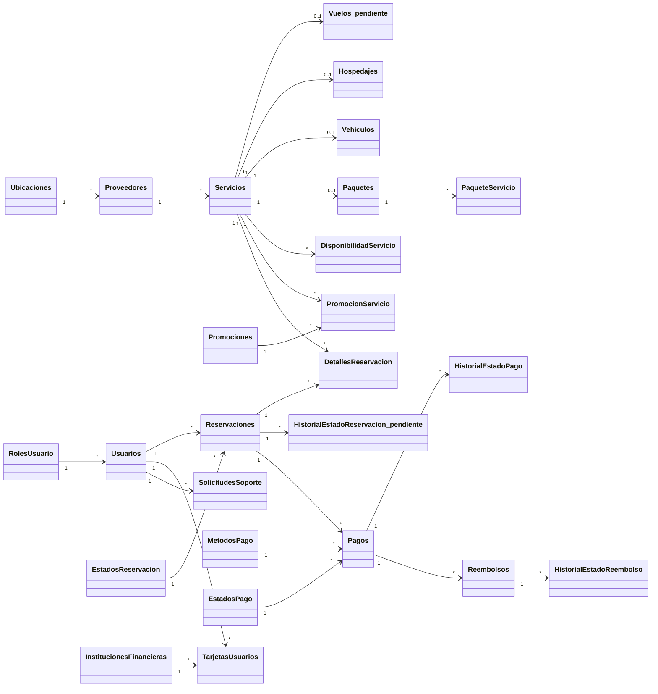

# 03 · Catálogo de modelos C# (`Models/`)

> **Para quién es este documento:** quien vaya a usar o modificar las clases de `Models/` (controladores, ViewModels, servicios).
>
> **Alcance:** solo las clases C#. La implementación física de la base de datos se documentará en una etapa posterior.

## Índice
1. [Panorama](#1-panorama)
2. [Convenciones actuales de las clases](#2-convenciones-actuales-de-las-clases)
3. [Catálogo por dominio](#3-catálogo-por-dominio)
4. [Diagrama de relaciones lógicas](#4-diagrama-de-relaciones-lógicas)
5. [Clases que faltan](#5-clases-que-faltan)
6. [Pendientes de estandarización](#6-pendientes-de-estandarización)

---

## 1. Panorama

| Dato | Valor |
|---|---|
| Clases de entidad | **24** |
| Otras clases | `ErrorViewModel` (plantilla ASP.NET) |
| Lógica de negocio en las clases | Ninguna (solo propiedades) |
| Propiedades de navegación | Ninguna (las relaciones son solo por identificadores) |
| Atributos de validación | Ninguno |
| ¿Algún controlador las usa? | Todavía no |
| Namespaces | **3 distintos**: `FlyVibeMex.Models` (4 archivos), `fvm` (13), `fvm.models` (8) |

Cada clase tiene ya comentarios XML (`/// 
`) con la regla de negocio que le aplica y comentarios `// FIXME:` donde hay inconsistencias.

## 2. Convenciones actuales de las clases

| Elemento | Convención actual | Ejemplo |
|---|---|---|
| Archivo | snake_case | `detalle_reservacion.cs` |
| Clase | PascalCase, casi siempre en plural | `DetallesReservacion` |
| Propiedades | snake_case, igual que el campo del diseño de datos | `id_reservacion`, `precio_unitario` |
| Llave primaria | `id` | `public ulong id {get; set;}` |
| Llaves foráneas | `id_<entidad>` | `id_usuario`, `id_servicio` |
| Textos | `string` inicializado con `string.Empty` | `public string nombre {get; set;} = string.Empty;` |
| Imágenes | `byte[]?` | `public byte[]? imagen {get; set;}` |

**Tipos C# usados**

| Para… | Tipo C# |
|---|---|
| Identificadores grandes | `ulong` |
| Identificadores de catálogos pequeños | `ushort` |
| Números pequeños (mes, capacidad) | `byte` |
| Cantidades enteras | `int` |
| Dinero y cantidades con decimales | `decimal` |
| Indicadores sí/no | `bool` |
| Fecha y hora | `DateTime` |
| Solo fecha | `DateOnly` |
| Solo hora | `TimeOnly` |
| Texto | `string` |
| Binarios (imágenes) | `byte[]?` |

> **NOTA:** los tipos sin signo (`ulong`, `ushort`) deberán revisarse cuando se defina la capa de acceso a datos (etapa posterior).

## 3. Catálogo por dominio

Leyenda de namespace: ✅ `FlyVibeMex.Models` (correcto) · ⚠️ `fvm` · ⚠️ `fvm.models`

### 3.1 Usuarios

| Archivo | Clase | Namespace | Representa | Propiedades clave | Notas |
|---|---|---|---|---|---|
| `roles_usuario.cs` | `RolesUsuario` | ⚠️ `fvm` | Roles de acceso (CLIENTE, AGENTE, ADMINISTRADOR) | `id`, `nombre` (único), `activo` | `descripcion` debería ser opcional (`string?`) |
| `usuario.cs` | `Usuarios` | ✅ | Cuentas de clientes, agentes y administradores | `id`, `id_rol` → RolesUsuario, `correo` (login), `password_hash` (R10), `activo`, `creado_en` | Falta `actualizado_en`; `imagen` agregada por el equipo |
| `ubicaciones.cs` | `Ubicaciones` | ⚠️ `fvm` | Direcciones reutilizables (proveedores, hospedajes, vuelos, retiro de vehículos) | `id`, `pais`, `estado`, `municipio_ciudad`, `codigo_postal`, `activo` | Faltan `colonia`, `calle`, `numero_exterior`, `numero_interior`, `referencias`; `correo` sobra; `creado`/`actualizado` son `string` y deberían ser `DateTime` |

### 3.2 Catálogo / Servicios

| Archivo | Clase | Namespace | Representa | Propiedades clave | Notas |
|---|---|---|---|---|---|
| `proveedores.cs` | `Proveedores` | ⚠️ `fvm` | Aerolíneas, hoteles, rentadoras y otros | `id`, `id_ubicacion` → Ubicaciones, `tipo_proveedor` (AEROLINEA, HOTEL, RENTADORA, OTRO), `activo` | `id_ubicacion` debería ser opcional |
| `servicios.cs` | `Servicios` | ⚠️ `fvm` | **Supertipo** de todo lo reservable (R1) | `id`, `id_proveedor` → Proveedores, `tipo_servicio` (VUELO, HOSPEDAJE, VEHICULO, PAQUETE), `precio_base`, `moneda` | No existe todavía el subtipo `Vuelos` |
| `hospedajes.cs` | `Hospedajes` | ⚠️ `fvm` | **Subtipo** HOSPEDAJE | `id`, `id_ubicacion`, `tipo_ubicacion`, `capacidad_huespedes`, `hora_entrada`, `hora_salida` | Debería identificarse por `id_servicio` (ligado 1:1 a su servicio); `tipo_ubicacion` debería ser `tipo_habitacion` |
| `vehiculos.cs` | `Vehiculos` | ⚠️ `fvm` | **Subtipo** VEHICULO | `id`, `id_ubicacion_retiro`, `categoria`, `marca`, `modelo`, `capacidad_pasajeros` | Debería identificarse por `id_servicio`; falta `transmision` |
| `paquete.cs` | `Paquetes` | ⚠️ `fvm` | **Subtipo** PAQUETE (R2) | `id`, `id_servicio`, `duracion_dias`, `min_personas`, `max_personas`, `politica_cancelacion` | `id` sobra (la identidad es `id_servicio`); `max_personas` y `politica_cancelacion` deberían ser opcionales |
| `paquete_servicio.cs` | `PaqueteServicio` | ⚠️ `fvm` | Servicios incluidos en un paquete (R2) | `id`, `id_servicio`, `id_servicio_incluido`, `cantidad`, `orden` | El diseño usa la pareja (`id_paquete`, `id_servicio_incluido`) |
| `disponibilidad_servicio.cs` | `DisponibilidadServicio` | ✅ | Inventario y precio **por fecha** (R3) | `id`, `id_servicio`, `fecha`, `cantidad_total`, `cantidad_disponible`, `precio_fecha` | — |

### 3.3 Promociones

| Archivo | Clase | Namespace | Representa | Propiedades clave | Notas |
|---|---|---|---|---|---|
| `promociones.cs` | `Promociones` | ⚠️ `fvm` | Promociones con vigencia (R13) | `id`, `codigo` (único), `tipo_descuento` (PORCENTAJE, MONTO), `valor`, `fecha_inicio`, `fecha_fin`, `activo` | Faltan `nombre` y `minimo_compra` |
| `promocion_servicio.cs` | `PromocionServicio` | ⚠️ `fvm` | Servicios a los que aplica cada promoción | `id_promocion`, `id_servicio` (clave compuesta) | — |

### 3.4 Reservaciones

| Archivo | Clase | Namespace | Representa | Propiedades clave | Notas |
|---|---|---|---|---|---|
| `estados_reservacion.cs` | `EstadosReservacion` | ⚠️ `fvm` | Catálogo de estados de una reserva (R6) | `id`, `nombre`, `es_final` | — |
| `reservaciones.cs` | `Reservaciones` | ⚠️ `fvm` | Encabezado de la reserva, con totales históricos (R4) | `id`, `id_usuario`, `id_estado_reservacion`, `codigo_reserva` (único), `subtotal`, `descuento_total`, `total` | Falta `actualizada_en` |
| `detalle_reservacion.cs` | `DetallesReservacion` | ✅ | Líneas de la reserva como **snapshot** (R4) | `id`, `id_reservacion`, `id_servicio`, `id_promocion`, `cantidad`, `precio_unitario`, `descuento_aplicado`, `subtotal`, `descripcion_snapshot` | Errata **`fehca_inicio`**; `id_promocion`, fechas deberían ser opcionales |

### 3.5 Pagos y reembolsos

| Archivo | Clase | Namespace | Representa | Propiedades clave | Notas |
|---|---|---|---|---|---|
| `metodos_pago.cs` | `MetodosPago` | ⚠️ `fvm` | Formas de pago aceptadas (R7) | `id`, `nombre`, `activo` | — |
| `instituciones_financieras.cs` | `InstitucionesFinancieras` | ⚠️ `fvm.models` | Bancos emisores (R7) | `id`, `nombre`, `clave_institucion`, `codigo_internacional` | Claves y teléfono deberían ser opcionales |
| `tarjetas_usuarios.cs` | `TarjetasUsuarios` | ⚠️ `fvm.models` | Tarjetas **tokenizadas** (R5) | `id`, `id_usuario`, `token_referencia`, `marca`, `ultimos4`, `mes_expiracion`, `anio_expiracion` | ⛔ Nunca agregar PAN ni CVV; `id_institucion` y `alias` deberían ser opcionales |
| `estados_pago.cs` | `EstadosPago` | ⚠️ `fvm.models` | Catálogo de estados de un pago (R6) | `id`, `nombre`, `es_final` | `es_final` es `byte`; debería ser `bool` como en `EstadosReservacion` |
| `pagos.cs` | `Pagos` | ⚠️ `fvm.models` | Intentos/transacciones de pago (R7) | `id`, `id_reservacion`, `id_metodo_pago`, `id_tarjeta`, `id_estado_pago`, `monto`, `referencia_externa` | `id_tarjeta`, `referencia_externa` y `fecha_pago` deberían ser opcionales |
| `historial_estado_pagos.cs` | `HistorialEstadoPago` | ⚠️ `fvm.models` | Bitácora de estados de pago (R6) | `id`, `id_pago`, `id_estado_pago`, `fecha_cambio`, `detalle` | Solo inserción |
| `reembolsos.cs` | `Reembolsos` | ⚠️ `fvm.models` | Devoluciones derivadas de un pago (R8) | `id`, `id_pago`, `monto`, `motivo`, `estado` (SOLICITADO, APROBADO, RECHAZADO, PROCESADO) | `fecha_resolucion` y `referencia_externa` deberían ser opcionales |
| `historial_estado_reembolso.cs` | `HistorialEstadoReembolso` | ⚠️ `fvm.models` | Bitácora de estados de reembolso (R6) | `id`, `id_reembolso`, `id_usuario_cambio`, `estado`, `fecha_cambio` | `id_usuario_cambio` debe poder ser nulo (cambio automático) |

### 3.6 Soporte

| Archivo | Clase | Namespace | Representa | Propiedades clave | Notas |
|---|---|---|---|---|---|
| `solicitudes_soporte.cs` | `SolicitudesSoporte` | ⚠️ `fvm.models` | Tickets unificados de asesoría y problemas (R9) | `id`, `id_usuario`, `id_reservacion`, `id_agente_asignado`, `tipo` (ASESORIA, PROBLEMA), `estado` (ABIERTA, EN_PROCESO, CERRADA) | `id_reservacion` e `id_agente_asignado` deberían ser opcionales. Punto de integración del futuro bot |

### 3.7 Plantilla

| Archivo | Clase | Namespace | Uso |
|---|---|---|---|
| `ErrorViewModel.cs` | `ErrorViewModel` | ✅ | Modelo de `Views/Shared/Error.cshtml` (`RequestId`, `ShowRequestId`) |

## 4. Diagrama de relaciones lógicas

Relaciones según el diseño del dominio (incluye las dos clases que faltan, marcadas con *).

## 5. Clases que faltan

| Clase | Por qué hace falta | Propiedades previstas en el diseño |
|---|---|---|
| `Vuelos` | Subtipo VUELO de `Servicios` (R1). Sin ella, la sección Viajes no tiene modelo | `id_servicio`, `id_origen` → Ubicaciones, `id_destino` → Ubicaciones, `codigo_vuelo`, `fecha_salida`, `fecha_llegada`, `clase` |
| `HistorialEstadoReservacion` | Bitácora de estados de la reserva (R6) | `id`, `id_reservacion`, `id_estado_reservacion`, `id_usuario_cambio` (opcional), `fecha_cambio`, `motivo` (opcional) |

## 6. Pendientes de estandarización

Se recomienda hacerlos **en un solo cambio coordinado** (una rama y un PR), porque afectan a todo el proyecto:

- [ ] **Unificar namespaces** en `FlyVibeMex.Models` (21 clases están en `fvm` o `fvm.models`). Hoy `_ViewImports.cshtml` solo importa `FlyVibeMex.Models`.
- [ ] **Corregir erratas:** `fehca_inicio` → `fecha_inicio` (`DetallesReservacion`); `tipo_ubicacion` → `tipo_habitacion` (`Hospedajes`).
- [ ] **Nulabilidad:** declarar como opcionales (`?`) los campos que el diseño permite vacíos (marcados con `FIXME` en cada clase).
- [ ] **Fechas como texto:** `Ubicaciones.creado` y `Ubicaciones.actualizado` deben ser `DateTime`.
- [ ] **Subtipos:** `Hospedajes`, `Vehiculos` y `Paquetes` deben identificarse por `id_servicio`.
- [ ] **Campos faltantes:** `Usuarios.actualizado_en`, `Reservaciones.actualizada_en`, `Promociones.nombre` y `minimo_compra`, `Vehiculos.transmision`, dirección completa en `Ubicaciones`.
- [ ] **Consistencia de tipos:** `EstadosPago.es_final` como `bool`.
- [ ] **Nombres de archivo** igual al nombre de la clase (`Usuarios.cs`), o al menos consistentes entre sí (hoy hay `usuario.cs` → `Usuarios`, `historial_estado_pagos.cs` → `HistorialEstadoPago`).
- [ ] **Decidir el estilo de propiedades:** mantener snake_case o pasar a PascalCase (ver [04 · Estándares](04_ESTANDARES_Y_HOJA_DE_RUTA_APP.md#5-decisiones-pendientes-del-equipo)).
- [ ] Crear las clases **`Vuelos`** y **`HistorialEstadoReservacion`**.
- [ ] Usar **ViewModels** para vistas y formularios en lugar de exponer estas entidades directamente (sobre todo `Usuarios`, por `password_hash`, y `TarjetasUsuarios`).
