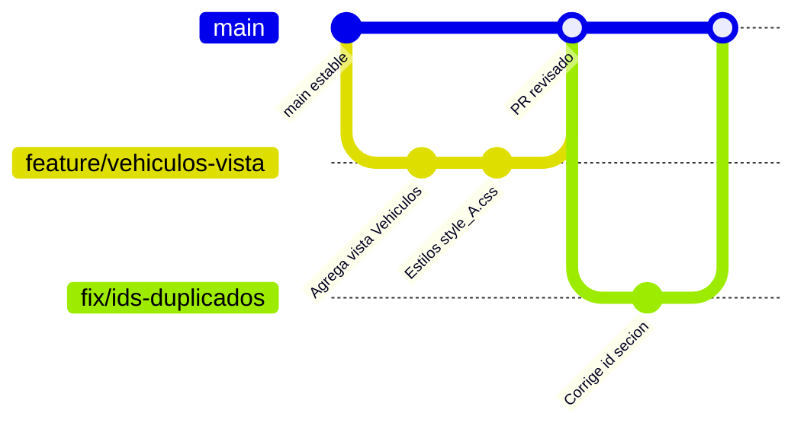
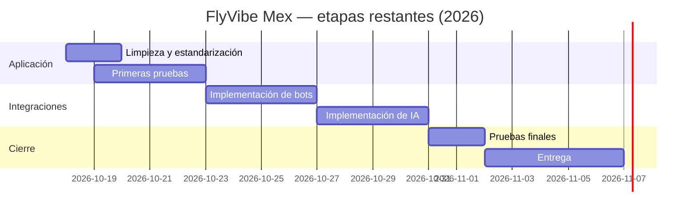

# 04 · Estándares de código y hoja de ruta de la aplicación

> **Para quién es este documento:** todo el equipo, antes de abrir una rama o un *pull request*. Reúne las reglas para escribir código consistente, el flujo de Git, la limpieza pendiente y lo que falta construir.
>
> **Alcance:** aplicación (C#, Razor, CSS y JS). La base de datos se trabajará y documentará en una etapa posterior.

## Índice
1. [Convenciones de código](#1-convenciones-de-código)
2. [Comentarios y etiquetas](#2-comentarios-y-etiquetas)
3. [Flujo de Git y pull requests](#3-flujo-de-git-y-pull-requests)
4. [Limpieza pendiente del repositorio](#4-limpieza-pendiente-del-repositorio)
5. [Decisiones pendientes del equipo](#5-decisiones-pendientes-del-equipo)
6. [Matriz de pantallas: prototipo vs. implementación](#6-matriz-de-pantallas-prototipo-vs-implementación)
7. [Hoja de ruta](#7-hoja-de-ruta)

---

## 1. Convenciones de código

### 1.1 C#
| Elemento | Regla |
|---|---|
| Namespace | `FlyVibeMex.<Carpeta>` (`FlyVibeMex.Models`, `FlyVibeMex.Controllers`, `FlyVibeMex.ViewModels`, `FlyVibeMex.Services`). Preferir namespace de archivo: `namespace FlyVibeMex.Models;` |
| Controladores | `<Nombre>Controller`, **siempre** con el sufijo `Controller` |
| Acciones | PascalCase (`Hoteles`, `Detalle`). Las existentes `sesion()` y `card()` se mantienen hasta coordinar el cambio con las llamadas de `cargarPagina` |
| Clases de modelo | PascalCase (hoy en plural: `Usuarios`, `Reservaciones`) |
| Propiedades de modelo | Hoy en snake_case igual al diseño de datos (`id_usuario`). Ver [decisión pendiente](#5-decisiones-pendientes-del-equipo) |
| Valores de estado o tipo | MAYÚSCULAS con guion bajo: `EN_PROCESO`, `HOSPEDAJE`, `PORCENTAJE` |
| Dinero | Siempre `decimal`, nunca `double` ni `float`. Los totales se calculan en el servidor |
| Opcionales | Si un dato puede faltar, la propiedad es nullable (`string?`, `ulong?`, `DateTime?`) |
| Formularios | Nunca enlazar entidades directamente: usar **ViewModels** con validaciones (`[Required]`, `[EmailAddress]`, `[Range]`) |
| POST | `[HttpPost]` + `[ValidateAntiForgeryToken]` + comprobar `ModelState.IsValid` |
| Datos sensibles | Nunca enviar `password_hash` a una vista; nunca manejar PAN ni CVV (regla R5) |

### 1.2 Razor / vistas
| Regla | Detalle |
|---|---|
| Ubicación | `Views/<Controlador>/<Accion>.cshtml` |
| Secciones del shell | `Layout = null;` obligatorio |
| Parciales reutilizables | Prefijo `_` (`_TarjetaServicio.cshtml`) |
| Ids | Únicos en el documento (hoy se repiten `secion` y `tarjetas`) |
| Encabezado | Cada vista inicia con un comentario `@* … *@` que dice qué pantalla es, su ruta, su CSS/JS y su estado |

### 1.3 CSS y JavaScript
| Regla | Detalle |
|---|---|
| Letra de sección | `style_<L>.css` y `script_<L>.js` (D, V, H, T, P, s). Registrar cualquier letra nueva en el documento 02 |
| Globales | `style.css` y `script.js` afectan a toda la página |
| Estilos | `class` para Bootstrap, `#id` para diseño propio |
| JS de sección | Cargarlo desde `Index.cshtml`; dentro de una vista parcial **no se ejecuta** |
| Recursos nuevos en `wwwroot/` | Recompilar (`dotnet run`) y refrescar con Ctrl + F5 |
| Textos visibles | Revisar ortografía y acentos ("sesión", "acceder", "FlyVibe Mex") |

### 1.4 Idioma
Español en nombres de dominio, interfaz, comentarios, commits y documentación.

## 2. Comentarios y etiquetas

| Etiqueta | Cuándo usarla | Ejemplo |
|---|---|---|
| `/// <summary>` | Documentar clases, acciones y propiedades en C# | Qué representa, qué regla de negocio aplica |
| `@* … *@` | Comentarios en Razor (no llegan al navegador) | Encabezado de cada vista |
| `/** … */` | JSDoc en funciones JS y encabezados de archivo | `cargarPagina(url)` |
| `// NOTA:` | Información importante que no es un error | "La clase está en plural y el archivo en singular" |
| `// TODO:` | Algo que falta construir | "Falta la acción Privacy()" |
| `// FIXME:` | Algo que está mal y debe corregirse | "Errata: fehca_inicio" |
| `FIXME: [DEUDA TÉCNICA]` | Problema estructural que afecta a varias partes | `DefaultController` |

Para ver todos los pendientes marcados en el código:
```bash
git grep -n -E "FIXME|TODO" -- Controllers Models Views wwwroot/assets
```

## 3. Flujo de Git y pull requests

### 3.1 Cómo trabajamos hoy
El historial muestra ramas por persona o por aportación (`testingyamil`, `mvctestgeneral`, `Aportación-de-Ruth`, `sqlyamil`…) que se integran a `main` mediante *pull requests* (PR #1 a #7).

### 3.2 Flujo recomendado


1. Actualizar `main`: `git checkout main && git pull`.
2. Crear una rama corta con prefijo según el tipo de cambio:
   - `feature/<modulo>-<descripcion>` → funcionalidad nueva (`feature/mis-viajes-listado`)
   - `fix/<descripcion>` → corrección (`fix/password-type`)
   - `docs/<descripcion>` → documentación
   - `refactor/<descripcion>` → reorganización sin cambiar comportamiento (`refactor/namespaces-models`)
3. Commits pequeños, en español y en imperativo, una intención por commit: `Agrega acción Privacy en HomeController`.
4. Antes del PR: `dotnet build` sin errores y revisar la aplicación en el navegador.
5. Abrir el PR hacia `main` con: qué cambia, cómo probarlo y capturas si toca la interfaz. Que lo revise al menos otro integrante.
6. Después de fusionar, borrar la rama.

### 3.3 Qué no se sube al repositorio
- `bin/`, `obj/`, `.vs/` (archivos generados al compilar o por Visual Studio).
- Secretos (contraseñas, claves de API, cadenas de conexión).
- Archivos comprimidos (`.rar`, `.zip`) con código: se suben los archivos en texto plano para poder revisarlos.
- Archivos temporales de Office (`~$*.docx`).

## 4. Limpieza pendiente del repositorio

### 4.1 Git
- [ ] Agregar al `.gitignore`:
  ```gitignore
  # Compilación y Visual Studio
  bin/
  obj/
  .vs/
  # Temporales de Office
  ~$*
  ```
- [ ] Quitar del índice lo ya versionado (no borra los archivos locales):
  ```bash
  git rm -r --cached bin obj
  git commit -m "Deja de versionar bin/ y obj/"
  ```

### 4.2 Código y archivos sin uso
- [ ] Eliminar `Controllers/DefaultController.cs` (duplicado; `/Default/*` da error 500).
- [ ] Agregar la acción `Privacy()` o eliminar `Views/Home/Privacy.cshtml` y sus enlaces.
- [ ] Eliminar `Views/Home/exIndex.cshtml`.
- [ ] Reparar o eliminar `Views/Shared/_Layout.cshtml` (rutas `~/lib/.../dist`, `~/css/site.css`, `~/js/site.js` inexistentes); si se elimina, dar a `Error.cshtml` su propio HTML.
- [ ] Eliminar o completar los JS vacíos: `app.js`, `script_D.js`, `script_H.js`, `script_P.js`, `script_T.js`, `script_V.js`; y `site.js`.
- [ ] Eliminar `originalstyles.css` (vacío) y `site.css` (plantilla, no se carga).
- [ ] Unificar `style_H.css`, `style_P.css`, `style_T.css` y `style_V.css` (son idénticos) en una hoja común para buscadores.
- [ ] Quitar el enlace de prueba **"VER TARJETA test"** del menú.
- [ ] Vaciar o completar `wwwroot/lib/` (solo contiene archivos LICENSE).

### 4.3 Interfaz (errores visibles)
- [ ] "FlyVideMex" → **FlyVibe Mex** (marca del navbar).
- [ ] "Iniciar secion" → **Iniciar sesión**; "Inicia sesion para aceder" → **Inicia sesión para acceder**.
- [ ] Contraseña con `type="password"` en `sesion.cshtml`.
- [ ] Logo: `` vacío en el navbar.
- [ ] Ids duplicados: `secion` (Index) y `tarjetas` (card).
- [ ] Clase `imf-fluid` → `img-fluid`.
- [ ] Botones con `href="#"` sin acción en Inicio ("Explorar opciones", "Mis Viajes").
- [ ] Título de la pestaña: "Proyecto final" → "FlyVibe Mex".

### 4.4 Documentación
- [x] Migrar `documento explicativos.txt` y el `.docx` a `docs/*.md`.
- [ ] Mantener este conjunto de documentos y `CONTEXTO_PROYECTO_FLYVIBEMEX.md` actualizados en el mismo PR que cambie la estructura.

## 5. Decisiones pendientes del equipo

| # | Decisión | Opciones | Recomendación |
|---|---|---|---|
| 1 | **Tours** | (a) Modelarlos como PAQUETE; (b) crear un tipo de servicio nuevo; (c) quitar la sección | (a): un tour es un paquete de un día sin cambiar el dominio |
| 2 | **Estilo de propiedades C#** | (a) Mantener snake_case (`id_usuario`); (b) PascalCase (`IdUsuario`) con mapeo explícito | Elegir una y aplicarla en un solo PR junto con la unificación de namespaces |
| 3 | **Regla class/#id** | (a) Mantenerla estricta y migrar `.mi-tarjeta`, `.search-card`…; (b) permitir clases propias con prefijo (`fv-`) | (b) es más práctica para componentes que se repiten (tarjetas) |
| 4 | **Navegación** | (a) Seguir con `cargarPagina` + `innerHTML`; (b) mejorarla con `history.pushState` y carga de scripts; (c) páginas MVC normales con `_Layout` | (c) simplifica formularios, validación, login y enlaces directos; (b) si se quiere conservar la experiencia sin recarga |
| 5 | **Letra para Vehículos** y otras secciones nuevas | Libre | Registrar en la tabla de letras del documento 02 |

## 6. Matriz de pantallas: prototipo vs. implementación

Pantallas del diseño de interfaz del documento de avance (30) frente a lo que existe hoy.

| Módulo | Pantalla del prototipo | ¿Existe? | Archivo actual | Qué falta |
|---|---|---|---|---|
| — | Home | 🟡 Parcial | `Index.cshtml` + `Default.cshtml` | Enlaces a Mis viajes, Soporte, Cuenta y Vehículos |
| Explorar y reservar | Explorar | 🟡 Parcial | `Default.cshtml` (tarjetas de categorías) | Falta Vehículos; botón "Explorar opciones" sin acción |
| | Paquetes | 🟡 Visual | `Paquetes.cshtml` | Búsqueda funcional |
| | Vuelos | 🟡 Visual | `Viajes.cshtml` | Búsqueda funcional; modelo `Vuelos` |
| | Hospedaje | 🟡 Visual | `Hoteles.cshtml` | Búsqueda funcional |
| | Vehículos | 🔴 No | — | Vista, acción, enlace en menú |
| | Promociones | 🔴 No | (solo banner en Inicio) | Vista de promociones vigentes |
| | Resultados | 🟡 Maqueta | columna `#tarjetas` + `card.cshtml` | Resultados reales y filtros |
| | Detalle | 🔴 No | — | Detalle del servicio con política de cancelación |
| | Resumen de reserva | 🔴 No | — | Resumen con promoción aplicada |
| | Pago | 🔴 No | — | Pago con tarjeta tokenizada u otro método |
| | Confirmación | 🔴 No | — | Código de reserva |
| Mis viajes | Mis viajes | 🔴 No | — | Requiere inicio de sesión |
| | Actuales | 🔴 No | — | Listado |
| | Pasados | 🔴 No | — | Listado |
| | Detalle de reservación | 🔴 No | — | Detalle con acciones |
| | Cancelar | 🔴 No | — | Confirmación de cancelación |
| | Solicitar reembolso | 🔴 No | — | Formulario |
| | Reportar problema | 🔴 No | — | Formulario (solicitud tipo PROBLEMA) |
| Soporte | Soporte | 🔴 No | (solo texto en Inicio) | Vista del módulo |
| | Contactar asesor | 🔴 No | — | Formulario (solicitud tipo ASESORIA) |
| Cuenta | Cuenta | 🔴 No | — | Vista del módulo |
| | Auth (iniciar sesión / registro) | 🟡 Visual | `sesion.cshtml` | Envío real, registro, cierre de sesión |
| | Perfil | 🔴 No | — | Datos del usuario y foto |
| | Métodos de pago | 🔴 No | — | Tarjetas tokenizadas guardadas |
| Panel interno | Panel | 🔴 No | — | Acceso solo AGENTE/ADMINISTRADOR |
| | Reservaciones | 🔴 No | — | Gestión |
| | Servicios y proveedores | 🔴 No | — | Catálogo e inventario por fecha |
| | Paquetes y promociones | 🔴 No | — | Gestión |
| | Solicitudes de soporte | 🔴 No | — | Asignación y seguimiento |

**Resumen:** 🟡 7 pantallas con avance visual o parcial · 🔴 23 por construir · fuera del diseño: **Tours** (`Tours.cshtml`).

## 7. Hoja de ruta

Alineada con el cronograma del proyecto (las fechas de las etapas 1 a 5 ya pasaron; el desarrollo del backend aún no inicia).



### Fase A — Limpieza y estandarización (inmediata)
- Ejecutar la [lista de limpieza](#4-limpieza-pendiente-del-repositorio) y las [decisiones pendientes](#5-decisiones-pendientes-del-equipo).
- Unificar namespaces y corregir erratas de modelos ([documento 03](03_CATALOGO_MODELOS_CSHARP.md#6-pendientes-de-estandarización)).

### Fase B — Pantallas y flujo de reserva
- Construir las pantallas 🔴 empezando por el flujo **Explorar → Resultados → Detalle → Resumen → Pago → Confirmación**.
- Crear **ViewModels** (búsqueda, resultado, resumen de reserva, login) y formularios con `name`, validación y antiforgery.
- Mover la lógica de negocio a servicios (`Services/`) inyectados en los controladores; los controladores solo validan, llaman al servicio y devuelven la vista.
- Inicio de sesión con cookies y roles (CLIENTE, AGENTE, ADMINISTRADOR) para Mis viajes, Cuenta y Panel interno.

### Fase C — Primeras pruebas (19–22 oct)
- Proyecto de pruebas xUnit: cálculo de totales y descuentos, transiciones de estado, reglas de inventario.
- Prueba manual de cada pantalla contra la matriz de la sección 6.

### Fase D — Bots (23–26 oct)
- Exponer rutas JSON (`/api/...`) para consultar servicios y crear solicitudes de soporte.
- El bot crea `SolicitudesSoporte` (ASESORIA o PROBLEMA) y consulta el estado de una reserva por su código; **nunca** procesa pagos ni ve datos de tarjetas. Escalamiento a humano: asignar un agente y pasar a EN_PROCESO.

### Fase E — Inteligencia artificial (27–30 oct)
- Encapsular el proveedor de IA detrás de una interfaz (p. ej. `IAsistenteViajes`) registrada en `Program.cs`, con la clave fuera del repositorio (`dotnet user-secrets`).
- Casos de uso acotados: recomendaciones a partir del catálogo real, resumen de itinerario de una reserva, clasificación de tickets de soporte.
- No enviar al modelo contraseñas, tokens de tarjeta ni datos personales innecesarios.

### Fase F — Pruebas finales y entrega (31 oct – 6 nov)
- Recorrer los 5 módulos completos, actualizar `README.md`, estos documentos y `CONTEXTO_PROYECTO_FLYVIBEMEX.md`.

> La conexión a la base de datos y su versión final se planificarán en una etapa posterior y se documentarán por separado.
