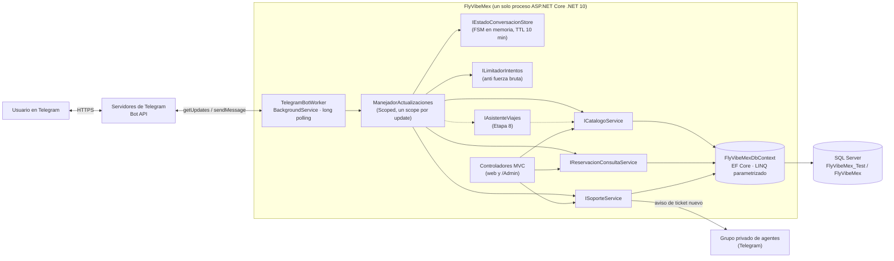
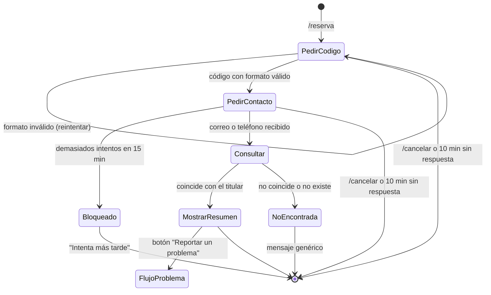
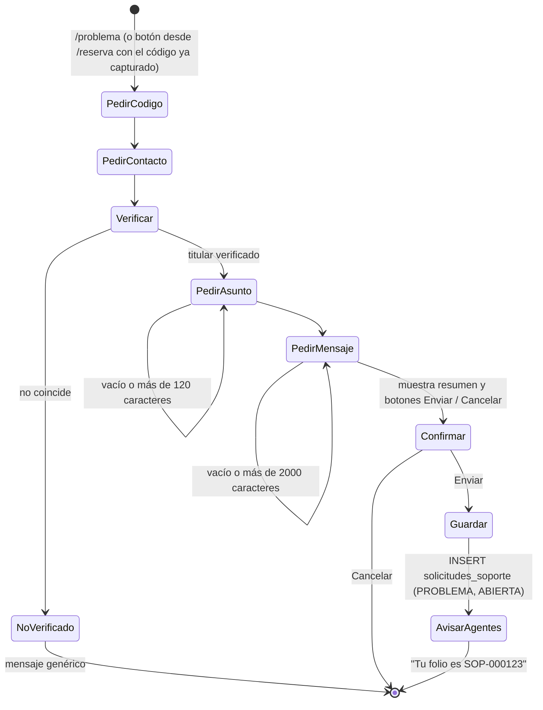
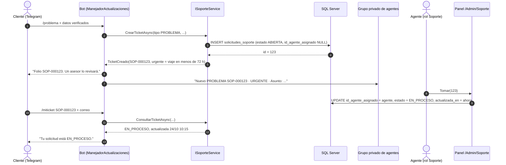

# 06 · Análisis y diseño del bot de Telegram

> Etapa 7 del cronograma (**Implementación de bots**, 23 – 26 oct 2026).
> Este documento evalúa las librerías .NET para Telegram, define qué hará el bot de FlyVibe Mex y deja un plan de 3 días para construir un MVP seguro.

| Campo | Valor |
|---|---|
| Fecha | 23/10/2026 |
| Base auditada | `main` en `c816f2d` ("Actualizacion del gitignore", 23/10/2026), después del PR #12 (`actualizacion-de-docs`) |
| Documentos relacionados | [`CONTEXTO_PROYECTO_FLYVIBEMEX.md`](../CONTEXTO_PROYECTO_FLYVIBEMEX.md), [01 · Visión y reglas](01_VISION_Y_REGLAS_DE_NEGOCIO.md), [03 · Modelos](03_CATALOGO_MODELOS_CSHARP.md), [05 · EF Core y seguridad](05_CONEXION_EFCORE_Y_SEGURIDAD.md) |
| Estado | Diseño aprobable. **Paso 0 (desbloqueo) hecho el 25/10/2026** sobre `main` en `949f1ae` (PR #13); el bot aún no está implementado |

## Índice
0. [Resumen ejecutivo](#0-resumen-ejecutivo)
1. [Punto de partida: estado real del repositorio](#1-punto-de-partida-estado-real-del-repositorio)
2. [Parte 1 · Evaluación de librerías](#2-parte-1--evaluación-de-librerías-net-para-telegram)
3. [Arquitectura del bot dentro de FlyVibe Mex](#3-arquitectura-del-bot-dentro-de-flyvibe-mex)
4. [Parte 2 · Catálogo de funciones](#4-parte-2--catálogo-de-funciones-del-bot)
5. [Flujos conversacionales](#5-flujos-conversacionales)
6. [Reglas de seguridad aplicadas](#6-reglas-de-seguridad-aplicadas)
7. [Plan de implementación MVP (3 días)](#7-plan-de-implementación-mvp-3-días)
8. [Cambios de esquema propuestos (fuera del MVP)](#8-cambios-de-esquema-propuestos-fuera-del-mvp)
9. [Decisiones pendientes del equipo](#9-decisiones-pendientes-del-equipo)
10. [Fuentes](#10-fuentes)

---

## 0. Resumen ejecutivo

- **Librería recomendada (Top 1): `Telegram.Bot`** (cliente oficial de la comunidad, 22.10.3.3 del 09/10/2026), integrada con un `BackgroundService` propio y *long polling* dentro del mismo `Program.cs` de la web. Usa las mismas piezas de ASP.NET Core que el equipo ya conoce (`AddDbContext`, servicios `Scoped`, `IServiceScopeFactory`, `dotnet user-secrets`) y no esconde nada detrás de un framework.
- **Alternativa (Top 2): `PRTelegramBot`** (1.1.2 del 10/10/2026), un framework encima de `Telegram.Bot` con comandos por atributos, menús, comandos paso a paso y `IHostedService`. Conviene si el equipo prefiere escribir menos código de enrutamiento a cambio de aprender sus convenciones.
- **El bot no es un sistema aparte:** vive dentro de la app web, reutiliza `FlyVibeMexDbContext` y servicios nuevos en `Services/` (catálogo, consulta de reservas, soporte) que después también usarán los controladores web.
- **MVP de 3 días:** `/start`, `/ayuda`, `/promos`, `/explorar`, `/reserva` (código + correo/teléfono), `/asesoria`, `/problema`, `/miticket` y aviso a un grupo privado de agentes. Nada de pagos, tarjetas ni contraseñas en el chat.
- **✅ Bloqueador previo resuelto (25/10/2026):** ver el estado de B1–B8 en la sección 1.2. Texto original del 23/10: por análisis estático, `main` **no compila** hoy. El PR #12 cambió los modelos (`Usuarios` → `UsuariosGlobales`, `fehca_inicio` → `fecha_inicio`, `id` eliminado en `Hospedajes`/`Vehiculos`/`Paquetes`/`PaqueteServicio`, `creado`/`actualizado` → `creado_en`/`actualizado_en`), pero `Data/FlyVibeMexDbContext.cs`, `Services/AuthService.cs`, `Program.cs` y `HomeController.TestDb` siguen usando los nombres viejos. Además, la BD de prueba solo tiene `roles_usuarios` y `usuarios`. **Sin corregir esto, el bot no puede consultar nada** (ver 1.2 y el Paso 0 del plan).

---

## 1. Punto de partida: estado real del repositorio

### 1.1 Lo que el bot puede aprovechar
| Pieza | Dónde | Para qué le sirve al bot |
|---|---|---|
| .NET 10 + ASP.NET Core MVC | `FlyVibeMex.csproj` (`net10.0`) | El bot se registra como `IHostedService` en el mismo host; no hace falta otro proyecto |
| EF Core 10 + `FlyVibeMexDbContext` (Scoped) | `Data/`, `Program.cs` | Consultas LINQ parametrizadas; conversores `ulong↔bigint` ya resueltos |
| `dotnet user-secrets` (`UserSecretsId` ya definido) | `FlyVibeMex.csproj` | Guardar `TelegramBot:Token` fuera de Git, igual que las cadenas de conexión |
| Patrón "configurado / sin configurar" | `Data/ConfiguracionBaseDatos.cs` | Copiarlo para que quien no tenga token pueda seguir ejecutando la web |
| `IAuthService.NormalizarCorreo` | `Services/AuthService.cs` | Normalizar el correo que escribe el usuario en el chat (sin pedir contraseña) |
| Modelo `SolicitudesSoporte` con nota "punto de integración del bot" | `Models/solicitudes_soporte.cs` | Destino de `/asesoria` y `/problema`; `id_reservacion` e `id_agente_asignado` ya son nullables |
| Panel `/Admin/Soporte` con acción `Tomar/{id}` (aún sin BD) | `Controllers/SoporteController.cs` | Donde el agente tomará los tickets que cree el bot (escalado a humano) |

### 1.2 Bloqueadores detectados (resolver antes de escribir el bot)
| # | Problema | Evidencia | Efecto | Corrección propuesta |
|---|---|---|---|---|
| B1 | La clase `Usuarios` ya no existe (ahora `UsuariosGlobales`, archivo `usuarioglobal.cs`) | `FlyVibeMexDbContext.cs:36,119`, `Program.cs:59`, `AuthService.cs:38,49,55,65,89,105,115,159,162`, `HomeController.cs:165-166` | Error de compilación | Cambiar los tipos a `UsuariosGlobales`; se puede conservar el nombre del `DbSet` (`Usuarios`) para no tocar las consultas |
| B2 | `DetallesReservacion.fehca_inicio` se renombró a `fecha_inicio` | `FlyVibeMexDbContext.cs:279` | Error de compilación | Borrar la línea `HasColumnName("fecha_inicio")` (ya coincide) |
| B3 | `Hospedajes`, `Vehiculos`, `Paquetes`, `PaqueteServicio` ya no tienen `id` | `FlyVibeMexDbContext.cs` (`ConfigurarCatalogo`) | Error de compilación | `HasKey(x => x.id_servicio)` en los tres subtipos; en `PaqueteServicio`, `HasKey(x => new { x.id_servicio, x.id_servicio_incluido })` |
| B4 | `Ubicaciones.creado`/`actualizado` (string) ahora son `creado_en`/`actualizado_en` (DateTime) | `FlyVibeMexDbContext.cs` (conversor `conversorFechaTexto`) | Error de compilación | Quitar el conversor; mapear `HasColumnName("creado")`/`("actualizado")` mientras el script SQL no se renombre |
| B5 | Las FK de usuario se renombraron en C# a `id_usuarioglobal`, pero la columna SQL sigue siendo `id_usuario` | `reservaciones.cs`, `solicitudes_soporte.cs` vs. script histórico (`3ccf80d`) | Fallo en tiempo de ejecución (columna inválida) | `e.Property(x => x.id_usuarioglobal).HasColumnName("id_usuario")` en `Reservaciones`, `SolicitudesSoporte` (y donde aplique) |
| B6 | `Vuelos` es una clase vacía y no está en el `DbContext`; `HistorialEstadoReservacion` tampoco | `Models/vuelos.cs`, `FlyVibeMexDbContext.cs` | El bot no puede mostrar origen/destino/horario de vuelos | En el MVP, los vuelos se muestran solo con los datos de `servicios`; completar `Vuelos` según el diagrama ER (contexto 4.2) |
| B7 | En `main` no hay script completo del esquema (solo `sql/00_db_prueba_conexion.sql` con 2 tablas) | `sql/` | Sin tablas de catálogo, reservas ni soporte no hay nada que consultar | Restaurar el script de `3ccf80d` como `sql/01_esquema.sql` con las correcciones del contexto 4.2 y crear `sql/02_seed_demo.sql` |
| B8 | Roles: el diseño habla de `CLIENTE`/`AGENTE`/`ADMINISTRADOR`; los paneles usan `Admin`, `SA`, `Soporte`, `GestorVentas` | `Controllers/*Controller.cs` (comentarios `[Authorize]`) | Ambigüedad sobre quién es "agente" | Este documento llama **agente** al rol `Soporte` del panel; acordar el nombre definitivo (sección 9) |

> No fue posible compilar en el entorno de esta auditoría (sin SDK de .NET); B1–B4 se detectaron leyendo el código. Confírmalos con `dotnet build` antes de empezar.

**Estado al 25/10/2026 (Paso 0):**

| # | Estado | Cómo quedó |
|---|---|---|
| B1–B4 | ✅ Resuelto | Yamil actualizó `DbContext`, `AuthService`, `Program.cs` y `HomeController` a los nombres nuevos (commits `aac7665` y `b374a35`). En el Paso 0 además: subtipos con `ValueGeneratedNever` (antes `Hospedajes`/`Vehiculos` tenían `ValueGeneratedOnAdd` y el `INSERT` habría fallado), limpieza de configuraciones duplicadas de `Paquetes`/`PaqueteServicio` y fechas de control con `CURRENT_TIMESTAMP` por defecto |
| B5 | ✅ Resuelto | `sql/01_esquema.sql` nombra cada columna igual que la propiedad (`id_usuarioglobal`, `id_usuariog`, `tipo_proveedor`, `creado_en`…); se quitaron los `HasColumnName`. Para bases viejas: `sql/03_alinear_nombres_legado.sql` |
| B6 | ✅ Resuelto | `Models/vuelos.cs` completada según el diagrama ER; `Vuelos` e `HistorialEstadoReservacion` mapeadas en el `DbContext` (`HistorialEstadoReservacion.id_estado_reservacion` pasó de `ulong` a `ushort` para poder ser FK a `estados_reservacion`) |
| B7 | ✅ Resuelto | `sql/01_esquema.sql` (24 tablas, con las correcciones de la sección 4.2 del contexto) y `sql/02_seed_demo.sql` (datos coherentes, incluida la reservación `FV-260901` del ejemplo 5.1) |
| B8 | ⏳ Pendiente | Decisión D2 (sección 9). Los datos demo usan los roles de `00`: `CLIENTE`, `AGENTE`, `ADMINISTRADOR` |

Verificación: `/Home/TestDb` ahora lee una fila de cada una de las 26 tablas y responde `"esquemaCompleto": true` si todas coinciden con los modelos.

### 1.3 Implicaciones para el diseño
- El bot debe ser **tolerante a datos incompletos**: si un hospedaje no tiene ubicación o un vuelo no tiene subtipo, se muestra lo que haya en `servicios`.
- **No hay login todavía**: cualquier función "de cuenta" debe verificarse con datos que el usuario ya conoce (código de reserva + correo/teléfono) y nunca con contraseña.
- La sección 6.4 del contexto proponía una API JSON (`/api/servicios`, `/api/reservaciones/{codigo}`, `/api/soporte`) para los bots. **Con el bot dentro del mismo proceso no hace falta pasar por HTTP**: el bot llama directo a los servicios. La API sigue siendo útil para canales externos (WhatsApp, IA de terceros) y usaría esos mismos servicios.

---

## 2. Parte 1 · Evaluación de librerías .NET para Telegram

### 2.1 Metodología
- Datos consultados el **23/10/2026** en NuGet.org y en cada repositorio de GitHub (versión, frameworks, dependencias, actividad). No se descargaron ni compilaron los paquetes: "compatible con `net10.0`" significa lo que NuGet declara o calcula a partir de los frameworks del paquete.
- Cuatro criterios pedidos por el equipo, calificados de 1 (malo) a 5 (excelente), con este peso para obtener un total sobre 5:

| Criterio | Peso | Por qué pesa así |
|---|---|---|
| A. Compatibilidad con .NET 10 y estabilidad/mantenimiento | 35 % | Quedan 3 días y el proyecto se evalúa: una librería abandonada o inmadura es el riesgo más caro |
| B. Integración con ASP.NET Core MVC + EF Core (hosted service, DI Scoped) | 25 % | Debe convivir con la web en el mismo `Program.cs` y usar `FlyVibeMexDbContext` sin trucos |
| C. Menús, comandos y estado conversacional (FSM) | 20 % | Los flujos `/reserva` y `/problema` piden varios pasos |
| D. Curva de aprendizaje y legibilidad para el equipo | 20 % | Cuatro integrantes deben poder agregar comandos sin sobreingeniería |

### 2.2 Ficha técnica de las 7 opciones
| # | Librería (paquete NuGet) | Última estable (fecha) | Frameworks del paquete | ¿`net10.0`? | Bot API | Base | Señales de mantenimiento |
|---|---|---|---|---|---|---|---|
| 1 | **Telegram.Bot** (`Telegram.Bot`) | 22.10.3.3 (09/10/2026) | `netstandard2.0`, `net6.0` | Sí (calculado desde `net6.0`) | 10.3 | Cliente HTTP propio | ~3.6 k ⭐, 10.7 M descargas, versión nueva cada ~2 semanas (25/08, 11/09, 25/09, 09/10) |
| 2 | **Telegram.BotAPI** (`Telegram.BotAPI`) | 10.2.0 (15/07/2026) | `netstandard2.0` | Sí (calculado) | 10.2 | Cliente HTTP propio | ~181 ⭐, ~166 k descargas, un mantenedor |
| 3 | **Telegram Bot Framework** (`TelegramBotBase`) | 7.2.0 (04/08/2026); 8.0.0-preview.2 (06/10/2026) | `netcoreapp3.1`, `net7.0`–`net10.0` | Sí (explícito) | La de `Telegram.Bot` ≥ 22.10.2.1 | `Telegram.Bot` | ~214 ⭐, activo; la 7.2.0 suma <1 k descargas |
| 4 | **PRTelegramBot** (`PRTelegramBot`) | 1.1.2 (10/10/2026) | `net6.0` | Sí (calculado) | 10.3 | `Telegram.Bot` ≥ 22.10.3 | ~40 ⭐, en desarrollo desde 2023, 1.0 estable en agosto 2026 con versionado semántico, ~32.6 k descargas |
| 5 | **cnet** (`cnet`) | 1.7.0 (todas sus versiones aparecen publicadas el 09/07/2026) | `net9.0` | Sí (calculado) | 10.1 | `Telegram.Bot` ≥ 22.10.1.1 | ~10 ⭐, 0 forks, 22 commits, ~1.2 k descargas |
| 6 | **Minimal Telegram Bot** (`MinimalTelegramBot`) | 0.1.0 (02/03/2026) | `net8.0`, `net9.0`, `net10.0` | Sí (explícito) | 9.5 (según su README) | `Telegram.Bot` | ~38 ⭐, pre‑1.0 ("puede haber cambios"), sin versión desde marzo |
| 7 | **RxTelegram.Bot** (`RxTelegram.Bot`) | 8.3.0 (16/04/2025) | `netstandard2.0`, `netstandard2.1` | Sí (calculado) | 8.3 (feb 2025) | Cliente propio + Newtonsoft.Json | ~44 ⭐, sin versión en 18 meses, 12 PR abiertos |

### 2.3 Matriz técnica comparativa
| Librería | A. .NET 10 / estabilidad | B. Integración MVC + EF Core | C. Menús / FSM | D. Curva para el equipo | **Total ponderado** |
|---|---|---|---|---|---|
| **1. Telegram.Bot** | **5** — la más usada y actualizada del ecosistema; todas las demás (3–6) dependen de ella | **5** — `BackgroundService` + `IServiceScopeFactory` + `ReceiveAsync`; 100 % ASP.NET Core estándar, sin reglas nuevas | **2** — no trae FSM ni enrutador: hay que escribir un `switch` de comandos y un almacén de estado (~80 líneas, ver 3.3) | **4** — API directa (`SendMessage`, `InlineKeyboardMarkup`), mucha documentación y ejemplos | **4.20** |
| 2. Telegram.BotAPI | 4 — al día con Bot API 10.2, pero menos comunidad | 3 — sin receptor de *polling*: el bucle `GetUpdates` y el manejo de `offset` son nuestros | 1 — nada de FSM ni enrutado | 3 — API completa pero menos ejemplos; no aporta nada frente a la #1 | 2.95 |
| 3. Telegram Bot Framework | 4 — activo y con `net10.0` explícito | 2 — ciclo de vida propio (`BotBaseBuilder…Build()`, `bot.Start()`); DI marcada como "Alpha" en sus ejemplos | **5** — formularios, `PromptDialog`, `CalendarPicker`, `ButtonGrid`, máquina de estados serializable (incluso en SQL Server) | 2 — paradigma tipo WinForms (formularios, eventos, navegación por pila): mucho que aprender para 3 días | 3.30 |
| **4. PRTelegramBot** | 4 — estable 1.x con semver, versiones mensuales; base pequeña | 4 — el bot es un `IHostedService`, soporta DI y tiene ejemplo ASP.NET Core (polling y webhook) | 4 — comandos por atributo (`[SlashHandler]`, `[ReplyMenuHandler]`), menús, constructores de teclados, comandos paso a paso, calendario | 3 — agregar un comando es agregar un método, pero trae convenciones propias (archivos de configuración por bot, métodos estáticos, middlewares) | **3.80** |
| 5. cnet | 1 — API muy buena, pero proyecto muy joven: un autor, 0 forks, todas las versiones del mismo día, solo `net9.0` | 5 — `AddCnet().OnCommand().UsePolling()` sobre `IServiceCollection`; resuelve handlers en un scope por update (sirve `DbContext`) | 5 — `Session().SetStateAsync()` + `OnState()`; rate limit y reintentos incluidos | 5 — la sintaxis más corta y clara de las siete | 3.60 |
| 6. Minimal Telegram Bot | 2 — pre‑1.0, sin versión desde marzo, Bot API atrasada | 2 — usa su propio host (`BotApplication.CreateBuilder`); meterlo en nuestra `WebApplication` MVC no es el camino documentado | 4 — paquete `StateMachine` aparte | 4 — estilo Minimal API, familiar | 2.80 |
| 7. RxTelegram.Bot | 1 — Bot API 8.3, sin publicar desde abril 2025 | 2 — sin hosting ni DI propios | 1 — nada | 1 — exige dominar Reactive Extensions (`IObservable`) | 1.25 |

**Lectura de la matriz.** Si solo importaran la sintaxis y la FSM, ganaría `cnet`. Pesa más el riesgo: un paquete con un solo autor, sin uso real y compilado únicamente para `net9.0` es una mala apuesta para entregar el 6 de noviembre. `Telegram.Bot` pierde en FSM, pero esa carencia se cubre con poco código propio que el equipo entiende línea por línea.

### 2.4 Comentario breve por librería
1. **Telegram.Bot.** Es la base de facto: PRTelegramBot, cnet, Minimal Telegram Bot y TelegramBotBase dependen de ella. Desde la v22 los métodos ya no llevan sufijo `Async` (`SendMessage`, `AnswerCallbackQuery`) y el receptor de *polling* (`ReceiveAsync`) viene incluido. Empezar aquí no cierra la puerta a migrar después a un framework construido encima.
2. **Telegram.BotAPI.** Muy completa y al día, pero es "otro cliente" equivalente al #1, con menos comunidad y sin receptor de *polling*. No hay razón para preferirla.
3. **Telegram Bot Framework.** La más rica en componentes visuales (calendario, rejillas con paginación). Su modelo de "formularios" con estado propio y su arranque independiente chocan con nuestra arquitectura MVC + DI; aprenderlo consumiría el sprint.
4. **PRTelegramBot.** El mejor equilibrio entre productividad y madurez. Riesgos: base de usuarios pequeña, parte de la comunidad en ruso (la documentación sí está en inglés) y dependencias `Microsoft.Extensions.Configuration.*` 9.x (NuGet resolverá a 10.x sin problema).
5. **cnet.** Diseño excelente (FSM, *throttling* de salida, *replay guard*, arnés de pruebas). Vale la pena vigilarlo, pero hoy es demasiado nuevo.
6. **Minimal Telegram Bot.** Idea atractiva, pero sigue en 0.x y pensada como aplicación propia, no como pieza dentro de una web MVC existente.
7. **RxTelegram.Bot.** Desactualizada frente a la Bot API y con un paradigma reactivo innecesario para este caso.

### 2.5 Veredicto
| Puesto | Librería | Justificación para FlyVibe Mex |
|---|---|---|
| **Top 1** | **Telegram.Bot 22.10.x** | Máxima estabilidad y documentación; se integra con primitivas que ya usa el proyecto (`AddDbContext` Scoped, `IServiceScopeFactory`, user-secrets); control total sobre seguridad y *logging*; la FSM que necesitamos (2 flujos de 2–3 pasos) cabe en una clase pequeña |
| **Top 2** | **PRTelegramBot 1.1.x** | Si el equipo quiere menús y comandos paso a paso "de fábrica", es la opción madura, ya es `IHostedService` y se apoya en `Telegram.Bot` (los tipos y métodos son los mismos) |
| Descartadas | Telegram.BotAPI, TelegramBotBase, cnet, MinimalTelegramBot, RxTelegram.Bot | Duplica a la #1 sin ventajas · paradigma pesado · inmadura · host propio y pre‑1.0 · desactualizada |

### 2.6 Esqueleto Top 1 — `Telegram.Bot` dentro de `Program.cs`

**Paquete**
```bash
dotnet add package Telegram.Bot   # 22.10.3.3 al 23/10/2026
```

**Secretos (cada integrante, en su máquina)**
```bash
dotnet user-secrets set "TelegramBot:Habilitado" "true"
dotnet user-secrets set "TelegramBot:Token" "123456789:AA...tu_token_de_BotFather"
dotnet user-secrets set "TelegramBot:ChatIdAgentes" "-1001234567890"   # grupo privado de agentes (opcional)
```

**`appsettings.json`** — solo valores no secretos; **la clave `Token` no se escribe aquí** para que nadie pegue el token por error:
```json
"TelegramBot": {
  "Habilitado": false,
  "UrlSitioWeb": "https://localhost:7045",
  "NombreUsuarioBot": "FlyVibeMexBot"
}
```

**`Bot/TelegramBotOpciones.cs`**
```csharp
namespace FlyVibeMex.Bot;

/// <summary>Configuración del bot. El token SOLO llega por user-secrets o variables de entorno.</summary>
public sealed class TelegramBotOpciones
{
    public const string Seccion = "TelegramBot";

    public bool Habilitado { get; set; }
    public string? Token { get; set; }              // NUNCA en appsettings.json ni en el código
    public long? ChatIdAgentes { get; set; }         // grupo privado donde se avisa de tickets nuevos
    public string UrlSitioWeb { get; set; } = "https://localhost:7045";
    public string? NombreUsuarioBot { get; set; }    // para construir t.me/<bot>?start=...

    public bool EstaConfigurado => Habilitado && !string.IsNullOrWhiteSpace(Token);
}
```

**`Program.cs`** (agregar después del bloque de servicios de la aplicación, antes de `builder.Build()`)
```csharp
using FlyVibeMex.Bot;      // ← estos dos using van al inicio de Program.cs
using Telegram.Bot;

// =============================================================================================
// Bot de Telegram (docs/06_ANALISIS_Y_DISENO_BOT_TELEGRAM.md)
// ---------------------------------------------------------------------------------------------
// Igual que la BD: si no está configurado, la web arranca normal y el bot simplemente no se inicia.
// =============================================================================================
var seccionBot = builder.Configuration.GetSection(TelegramBotOpciones.Seccion);
builder.Services.Configure<TelegramBotOpciones>(seccionBot);
var opcionesBot = seccionBot.Get<TelegramBotOpciones>() ?? new TelegramBotOpciones();

// Servicios de dominio reutilizables por el bot Y por los controladores web (Scoped, como el DbContext).
builder.Services.AddScoped<ICatalogoService, CatalogoService>();
builder.Services.AddScoped<IReservacionConsultaService, ReservacionConsultaService>();
builder.Services.AddScoped<ISoporteService, SoporteService>();

if (opcionesBot.EstaConfigurado)
{
    // Cliente único (singleton). Se crea sin IHttpClientFactory a propósito: su logging de nivel
    // Information escribiría la URL https://api.telegram.org/bot<TOKEN>/... en la consola.
    builder.Services.AddSingleton<ITelegramBotClient>(_ => new TelegramBotClient(opcionesBot.Token!));
    builder.Services.AddSingleton<IEstadoConversacionStore, EstadoConversacionEnMemoria>();
    builder.Services.AddSingleton<ILimitadorIntentos, LimitadorIntentosEnMemoria>();
    builder.Services.AddScoped<ManejadorActualizaciones>();   // un scope por update
    builder.Services.AddHostedService<TelegramBotWorker>();    // long polling
}
```
Y en el registro de arranque, junto al de la BD:
```csharp
app.Logger.LogInformation("Bot de Telegram: {Estado}.",
    opcionesBot.EstaConfigurado ? "activo (long polling)" : "desactivado (falta TelegramBot:Habilitado/Token)");
```

**`Bot/TelegramBotWorker.cs`** — recibe updates por *long polling* y abre un scope de DI por cada uno
```csharp
using Telegram.Bot;
using Telegram.Bot.Polling;
using Telegram.Bot.Types;
using Telegram.Bot.Types.Enums;

namespace FlyVibeMex.Bot;

public sealed class TelegramBotWorker(
    ITelegramBotClient bot,
    IServiceScopeFactory scopes,
    ILogger<TelegramBotWorker> logger) : BackgroundService
{
    protected override async Task ExecuteAsync(CancellationToken detener)
    {
        // Long polling y webhook no pueden convivir: se borra cualquier webhook previo.
        await bot.DeleteWebhook(dropPendingUpdates: true, cancellationToken: detener);
        await bot.SetMyCommands(ComandosBot.Menu, cancellationToken: detener);

        var opciones = new ReceiverOptions
        {
            AllowedUpdates = [UpdateType.Message, UpdateType.CallbackQuery],
            DropPendingUpdates = true,
        };

        logger.LogInformation("Bot de Telegram escuchando (long polling).");

        await bot.ReceiveAsync(
            updateHandler: async (cliente, update, ct) =>
            {
                try
                {
                    // Un scope por update: DbContext y servicios Scoped nuevos, como en una petición web.
                    await using var scope = scopes.CreateAsyncScope();
                    var manejador = scope.ServiceProvider.GetRequiredService<ManejadorActualizaciones>();
                    await manejador.ManejarAsync(update, ct);
                }
                catch (Exception ex) when (ex is not OperationCanceledException)
                {
                    // Solo metadatos: nunca el texto del mensaje (puede traer correos o teléfonos).
                    logger.LogError(ex, "Error al procesar el update {UpdateId} ({Tipo}).", update.Id, update.Type);
                }
            },
            errorHandler: (cliente, ex, origen, ct) =>
            {
                logger.LogWarning(ex, "Error del receptor de Telegram ({Origen}).", origen);
                return Task.CompletedTask;
            },
            receiverOptions: opciones,
            cancellationToken: detener);
    }
}
```

**`Bot/ComandosBot.cs`**
```csharp
using Telegram.Bot.Types;

namespace FlyVibeMex.Bot;

public static class ComandosBot
{
    public static readonly BotCommand[] Menu =
    [
        new() { Command = "start",    Description = "Bienvenida y menú principal" },
        new() { Command = "explorar", Description = "Ver vuelos, hospedaje, vehículos y paquetes" },
        new() { Command = "promos",   Description = "Promociones vigentes" },
        new() { Command = "reserva",  Description = "Consultar el estado de una reservación" },
        new() { Command = "asesoria", Description = "Pedir ayuda a un asesor" },
        new() { Command = "problema", Description = "Reportar un problema con una reservación" },
        new() { Command = "miticket", Description = "Consultar una solicitud de soporte" },
        new() { Command = "ayuda",    Description = "Políticas, horarios y métodos de pago" },
        new() { Command = "cancelar", Description = "Cancelar la conversación actual" },
    ];
}
```

> Los esqueletos siguen la API de `Telegram.Bot` 22.x (métodos sin sufijo `Async`, `ReceiveAsync` con `HandleErrorSource`). Son orientativos: confirmen firmas con IntelliSense al instalar el paquete.

### 2.7 Esqueleto Top 2 — `PRTelegramBot` (solo si el equipo elige la alternativa)
```bash
dotnet add package PRTelegramBot   # 1.1.2 al 23/10/2026 (trae Telegram.Bot ≥ 22.10.3)
```
```csharp
// Program.cs — orientativo: copiar el registro exacto de Examples/AspNetExample del repositorio,
// que muestra el bot como IHostedService con handlers resueltos por DI.
var tokenBot = builder.Configuration["TelegramBot:Token"];   // desde user-secrets
// builder.Services.Add...  (según el ejemplo AspNetExample)

// Handlers: un método por comando, descubierto por reflexión al arrancar.
public static class ComandosPublicos
{
    [SlashHandler("/promos")]
    public static async Task Promos(IBotContext contexto)
    {
        // Obtener ICatalogoService desde el contenedor (ver "Dependency injection" en su documentación)
        // y responder con MessageSender.Send(contexto, texto).
    }
}
```
Los servicios de dominio (`ICatalogoService`, etc.) y las reglas de seguridad de este documento **son idénticos** con cualquiera de las dos librerías; solo cambia la capa de enrutamiento.

### 2.8 Long polling vs. webhook
| Aspecto | Long polling (desarrollo y demo) | Webhook (despliegue) |
|---|---|---|
| Requisito de red | Ninguno: funciona en `localhost:5106`/`7045` sin túnel | URL HTTPS pública con certificado válido (puertos 443, 80, 88 u 8443) |
| Cómo se registra | `TelegramBotWorker` (`BackgroundService`) | Endpoint `POST /api/telegram/webhook` + `SetWebhook(url, secretToken: ...)`; validar la cabecera `X-Telegram-Bot-Api-Secret-Token` |
| Restricción | **Un solo proceso por token** puede hacer `getUpdates`; un segundo devuelve *409 Conflict* | No se puede usar `getUpdates` mientras haya webhook |
| Recomendación | **Usar en el MVP** | Solo si se publica en un servidor; el manejador (`ManejadorActualizaciones`) es el mismo |

> **Un bot de prueba por integrante.** Como solo un proceso puede leer cada token, cada quien crea su propio bot en @BotFather (`/newbot`, por ejemplo `FlyVibeMexAxelDevBot`) y guarda su token en sus user-secrets. El token "oficial" lo usa solo la máquina de la demo. Si un token se filtra: @BotFather → `/revoke`.

---

## 3. Arquitectura del bot dentro de FlyVibe Mex

### 3.1 Vista general

Ideas clave:
- **Los servicios son de la aplicación, no del bot.** `ICatalogoService`, `IReservacionConsultaService` e `ISoporteService` viven en `Services/` y devuelven DTO; el día que la web tenga "Mis viajes" o el formulario de soporte, usará los mismos métodos.
- **El bot no conoce SQL ni entidades con datos sensibles.** Recibe DTO sin `password_hash`, sin tarjetas y sin correo/teléfono completos.
- **Cero lógica de negocio en el manejador**: valida la entrada, llama un servicio, formatea la respuesta (mismo principio de "controladores delgados" de la regla 6 del contexto).

### 3.2 Estructura de carpetas propuesta
```
FlyVibeMex/
├── Bot/                                   ← solo la capa Telegram (enrutamiento y formato)
│   ├── TelegramBotOpciones.cs
│   ├── TelegramBotWorker.cs               ← BackgroundService (long polling)
│   ├── ManejadorActualizaciones.cs        ← router: comandos, callbacks y pasos de la FSM
│   ├── ComandosBot.cs                     ← menú de comandos (SetMyCommands)
│   ├── EstadoConversacion.cs              ← IEstadoConversacionStore + implementación en memoria
│   ├── LimitadorIntentos.cs               ← ILimitadorIntentos (por chat y por acción)
│   ├── Flujos/                            ← un archivo por flujo de varios pasos
│   │   ├── FlujoConsultaReserva.cs
│   │   └── FlujoTicketSoporte.cs
│   └── Formatos/MensajesBot.cs            ← textos y teclados (HTML de Telegram, escapado)
├── Services/
│   ├── ICatalogoService.cs / CatalogoService.cs
│   ├── IReservacionConsultaService.cs / ReservacionConsultaService.cs
│   └── ISoporteService.cs / SoporteService.cs
└── Models/Bot/                            ← DTO de salida (ServicioResumen, ReservaResumen, TicketCreado…)
```

### 3.3 Estado conversacional (FSM mínima)
Telegram entrega mensajes sueltos; para un flujo como "código → correo → resultado" hay que recordar en qué paso va cada chat. Con `Telegram.Bot` se resuelve con un almacén pequeño:

```csharp
using System.Collections.Concurrent;

namespace FlyVibeMex.Bot;

/// <summary>Paso actual de un chat dentro de un flujo de varios mensajes.</summary>
public sealed record EstadoConversacion(
    string Flujo,                          // "RESERVA", "TICKET"
    string Paso,                           // "PEDIR_CODIGO", "PEDIR_CONTACTO", ...
    IReadOnlyDictionary<string, string> Datos,
    DateTimeOffset ExpiraEn);

public interface IEstadoConversacionStore
{
    EstadoConversacion? Obtener(long chatId);
    void Guardar(long chatId, string flujo, string paso, IReadOnlyDictionary<string, string> datos);
    void Limpiar(long chatId);
}

/// <summary>
/// Implementación en memoria: suficiente para un solo servidor. Si la app se reinicia, el usuario
/// solo repite el flujo (no se pierde nada importante porque nada se guarda hasta el último paso).
/// </summary>
public sealed class EstadoConversacionEnMemoria(TimeProvider reloj) : IEstadoConversacionStore
{
    private static readonly TimeSpan Vigencia = TimeSpan.FromMinutes(10);
    private readonly ConcurrentDictionary<long, EstadoConversacion> _estados = new();

    public EstadoConversacion? Obtener(long chatId)
    {
        if (!_estados.TryGetValue(chatId, out var estado)) return null;
        if (estado.ExpiraEn > reloj.GetUtcNow()) return estado;
        _estados.TryRemove(chatId, out _);
        return null;
    }

    public void Guardar(long chatId, string flujo, string paso, IReadOnlyDictionary<string, string> datos) =>
        _estados[chatId] = new EstadoConversacion(flujo, paso, datos, reloj.GetUtcNow() + Vigencia);

    public void Limpiar(long chatId) => _estados.TryRemove(chatId, out _);
}
```
(Registrar `TimeProvider.System` como singleton, o usar `DateTimeOffset.UtcNow` directamente si se prefiere simplicidad.)

**Orden de decisión en `ManejadorActualizaciones`:**
1. Si es un *callback* (botón) → atender por prefijo (`cat:`, `srv:`, `fecha:`, `pol:`).
2. Si el texto empieza con `/` → es un comando; `/cancelar` limpia el estado; cualquier otro comando **reinicia** el flujo en curso.
3. Si el chat tiene un estado vigente → el texto es la respuesta al paso actual.
4. Si no → respuesta por defecto (menú) o, a partir de la Etapa 8, pregunta libre al asistente.

El *polling* de `Telegram.Bot` entrega los updates en orden y de uno en uno, así que dos mensajes del mismo chat no se procesan en paralelo.

### 3.4 Ejemplo de servicio de dominio (consulta de reserva)
```csharp
namespace FlyVibeMex.Services;

public sealed record LineaReserva(string Descripcion, decimal Cantidad, DateTime FechaInicio, DateTime FechaFin, decimal Subtotal);
public sealed record ReservaResumen(
    string Codigo, string Estado, string Moneda, decimal Subtotal, decimal Descuento, decimal Total,
    DateTime CreadaEn, IReadOnlyList<LineaReserva> Lineas, string? EstadoPago, string? EstadoReembolso);

public interface IReservacionConsultaService
{
    /// <summary>Devuelve la reserva SOLO si el contacto coincide con el titular; si no, null (sin decir por qué).</summary>
    Task<ReservaResumen?> ConsultarAsync(string codigoReserva, string correoOTelefono, CancellationToken ct = default);
}

public sealed class ReservacionConsultaService(FlyVibeMexDbContext db, IAuthService auth) : IReservacionConsultaService
{
    public async Task<ReservaResumen?> ConsultarAsync(string codigoReserva, string correoOTelefono, CancellationToken ct = default)
    {
        var codigo = codigoReserva.Trim().ToUpperInvariant();
        var correo = auth.NormalizarCorreo(correoOTelefono);
        var telefono = new string(correoOTelefono.Where(char.IsDigit).ToArray());

        // LINQ => SQL parametrizado. Nada de concatenar texto del usuario.
        var reserva = await (
            from r in db.Reservaciones.AsNoTracking()
            join u in db.Usuarios.AsNoTracking() on r.id_usuarioglobal equals u.id     // DbSet de UsuariosGlobales
            join e in db.EstadosReservacion.AsNoTracking() on r.id_estado_reservacion equals e.id
            where r.codigo_reserva == codigo
               && u.activo
               && (u.correo == correo || (telefono.Length >= 10 && u.telefono == telefono))
            select new { r.id, r.codigo_reserva, Estado = e.nombre, r.moneda, r.subtotal, r.descuento_total, r.total, r.creada_en })
            .FirstOrDefaultAsync(ct);

        if (reserva is null) return null;

        var lineas = await db.DetallesReservacion.AsNoTracking()
            .Where(d => d.id_reservacion == reserva.id)
            .OrderBy(d => d.fecha_inicio)
            .Select(d => new LineaReserva(d.descripcion_snapshot, d.cantidad, d.fecha_inicio, d.fecha_fin, d.subtotal))
            .ToListAsync(ct);                                                          // snapshot histórico (R4)

        var estadoPago = await (
            from p in db.Pagos.AsNoTracking()
            join ep in db.EstadosPago.AsNoTracking() on p.id_estado_pago equals ep.id
            where p.id_reservacion == reserva.id
            orderby p.creado_en descending
            select ep.nombre).FirstOrDefaultAsync(ct);                                 // sin tarjeta ni referencia externa

        var estadoReembolso = await (
            from rb in db.Reembolsos.AsNoTracking()
            join p in db.Pagos.AsNoTracking() on rb.id_pago equals p.id
            where p.id_reservacion == reserva.id
            orderby rb.fecha_solicitud descending
            select rb.estado).FirstOrDefaultAsync(ct);

        return new ReservaResumen(reserva.codigo_reserva, reserva.Estado, reserva.moneda, reserva.subtotal,
            reserva.descuento_total, reserva.total, reserva.creada_en, lineas, estadoPago, estadoReembolso);
    }
}
```
Notas: el teléfono se guarda hoy como texto libre (`varchar(20)`); acordar un formato (solo 10 dígitos) para que la comparación funcione. Si el modelo `Usuarios` se renombra en el `DbContext`, ajustar `db.Usuarios`.

---

## 4. Parte 2 · Catálogo de funciones del bot

Convenciones de las tablas: **MVP** = entra en los 3 días; **F2** = fase 2 (después del MVP o junto con la IA). Las tablas se nombran como en SQL; entre paréntesis la clase C#.

### 4.1 Módulo 1 · Exploración, catálogo y promociones (público, sin identificación)
| # | Comando / flujo | Experiencia del usuario | Tablas (modelos) | Complejidad | Fase |
|---|---|---|---|---|---|
| 1.1 | `/start` (y `/start <payload>`) | Saludo, qué es FlyVibe Mex y botones: *Explorar · Promociones · Mi reserva · Soporte*. Si llega desde la web con `t.me/<bot>?start=reserva`, salta directo al flujo correspondiente | — | Baja | MVP |
| 1.2 | `/explorar` → botón de categoría | Botones *Vuelos · Hospedaje · Vehículos · Paquetes*; al elegir, hasta 5 servicios activos con nombre, "desde $precio_base MXN" y un dato del subtipo: hospedaje (categoría, capacidad, ciudad), vehículo (marca/modelo, pasajeros, ciudad de retiro), paquete (días, mín./máx. personas). Botón *Ver más* pagina de 5 en 5 | `servicios` (`Servicios`), `hospedajes`, `vehiculos`, `paquete`, `ubicaciones` | Media | MVP |
| 1.3 | Detalle de un servicio (botón `srv:<id>`) | Ficha del servicio: descripción, proveedor, datos del subtipo y botones *Ver fechas* y *Reservar en la web* | `servicios`, `proveedores`, subtipos, `ubicaciones` | Baja | MVP |
| 1.4 | `/destino <ciudad>` (o texto tras el botón *Buscar por destino*) | "¿A dónde quieres ir?" → busca coincidencias en ciudad/estado y lista hospedajes y vehículos en ese lugar (y vuelos con ese destino cuando exista `vuelos`) | `ubicaciones`, `hospedajes.id_ubicacion`, `vehiculos.id_ubicacion_retiro`, `vuelos.id_destino` (pendiente), `servicios` | Media | MVP (sin vuelos) |
| 1.5 | *Ver fechas* (callback `fecha:<id>`) | Botones con los próximos 7 días que tengan cupo; al elegir uno: "Disponibles: N · Precio para esa fecha: $X". Precio y cupo son informativos: la web los recalcula al reservar | `disponibilidad_servicio` (`DisponibilidadServicio`) | Media | MVP |
| 1.6 | `/promos` | Promociones con `activo = 1` y fecha actual entre `fecha_inicio` y `fecha_fin`: nombre, código, "-15 %" o "-$500", compra mínima y a qué servicios aplica | `promociones`, `promocion_servicio`, `servicios` | Baja | MVP |
| 1.7 | Botón *Reservar en la web* | Botón URL hacia la página del servicio en el sitio (`{UrlSitioWeb}/...`). Con `localhost` el enlace solo abre en la misma computadora; en la demo, enviar el enlace como texto si Telegram rechaza el botón | — (configuración) | Baja | MVP |
| 1.8 | Enlace web → bot | En el pie de la web, "Escríbenos por Telegram": `https://t.me/<bot>?start=soporte`. El `payload` solo admite `A-Z a-z 0-9 _ -` (máx. 64) | — | Baja | MVP |
| 1.9 | Suscripción a promociones | `/avisos` guarda el chat para enviarle promociones nuevas | Tabla nueva (sección 8) | Media | F2 |

### 4.2 Módulo 2 · Consulta de reservaciones ("Mis viajes" vía bot)
| # | Comando / flujo | Experiencia del usuario | Tablas (modelos) | Complejidad | Fase |
|---|---|---|---|---|---|
| 2.1 | `/reserva` (FSM de 2 pasos) | 1) "Escribe tu código de reserva (ej. FV-260901)". 2) "Escribe el correo o teléfono con el que reservaste". Si coinciden: resumen; si no: mensaje **genérico** ("No encontramos una reservación con esos datos") sin decir qué dato falló | `reservaciones`, `usuarios` (`UsuariosGlobales`: solo `correo`, `telefono`, `activo`) | Media | MVP |
| 2.2 | Resumen de lo contratado | Estado actual, fecha de compra, líneas del **snapshot** (descripción, cantidad, fechas, subtotal) y totales históricos. Saluda solo con el nombre de pila | `estados_reservacion`, `detalle_reservacion` (`DetallesReservacion`), `reservaciones` | Baja (sobre 2.1) | MVP |
| 2.3 | Estado del pago y del reembolso | "Pago: APROBADO", "Reembolso: SOLICITADO". Nunca marca de tarjeta, últimos 4 dígitos ni referencia del gateway | `pagos`, `estados_pago`, `reembolsos` | Baja | MVP |
| 2.4 | Botones de seguimiento | Tras el resumen: *Reportar un problema con esta reserva* (abre 3.2 con el folio ya capturado) y *Ver en la web* | — | Baja | MVP |
| 2.5 | Historial de cambios de estado | "CONFIRMADA el 12/10 · CANCELADA el 15/10" | `historial_estado_reservacion` (falta en `DbContext`) | Baja | F2 |
| 2.6 | `/misviajes` (todas las reservas, actuales y pasadas) | Lista de reservas del titular | `reservaciones`, `detalle_reservacion` | Media | F2 — requiere cuenta vinculada (sección 8); con solo correo sería demasiado fácil espiar a otros |
| 2.7 | Recordatorio antes del viaje | Mensaje 24 h antes de `fecha_inicio` | `detalle_reservacion` + tabla de vinculación | Media | F2 |

**Fuera de alcance a propósito:** cancelar una reservación o solicitar un reembolso desde el bot. Son operaciones con dinero e irreversibles; se hacen en la web, con sesión iniciada y confirmación. El bot solo ofrece el enlace.

### 4.3 Módulo 3 · Atención al cliente y soporte (`solicitudes_soporte`, regla R9)
| # | Comando / flujo | Experiencia del usuario | Tablas (modelos) | Complejidad | Fase |
|---|---|---|---|---|---|
| 3.1 | `/asesoria` (FSM de 3 pasos) | 1) Asunto (máx. 120 caracteres). 2) Mensaje. 3) Correo de su cuenta. Respuesta **uniforme**: "Recibimos tu solicitud; si el correo pertenece a una cuenta de FlyVibe Mex, un asesor te contactará". Si el correo existe se inserta el ticket `ASESORIA`/`ABIERTA`; el folio **no** se muestra en el chat (mostrarlo solo cuando el correo existe revelaría qué correos tienen cuenta) y el asesor responde por correo. Quien no tiene cuenta no puede abrir ticket porque `id_usuarioglobal` es obligatorio (decisión en la sección 9) | `solicitudes_soporte` (`SolicitudesSoporte`), `usuarios` | Media | MVP |
| 3.2 | `/problema` (FSM de 4 pasos) | 1) Código de reserva. 2) Correo o teléfono (misma verificación que 2.1). 3) Asunto. 4) Descripción. Inserta `PROBLEMA`/`ABIERTA` con `id_reservacion` e `id_usuarioglobal` del titular y responde con folio `SOP-000123` | `solicitudes_soporte`, `reservaciones`, `usuarios` | Media | MVP |
| 3.3 | `/miticket` | Folio + correo → "SOP-000123 · EN_PROCESO · actualizada el 24/10 10:15". Si no coincide, mensaje genérico | `solicitudes_soporte`, `usuarios` | Baja | MVP |
| 3.4 | Escalado a agente humano | Al crearse un ticket, el bot publica en un **grupo privado de agentes** (`TelegramBot:ChatIdAgentes`): folio, tipo, asunto y, si es `PROBLEMA` con viaje en las próximas 72 h, la etiqueta **URGENTE**. El agente lo toma en `/Admin/Soporte` (acción `Tomar/{id}`), que asigna `id_agente_asignado` y pasa el ticket a `EN_PROCESO`. El bot **no** asigna agentes por su cuenta | `solicitudes_soporte`, `detalle_reservacion` (fecha más próxima) | Media | MVP (aviso); toma desde Telegram en F2 |
| 3.5 | `/ayuda` · centro de ayuda | Menú: *Políticas de cancelación · Horarios de check‑in/out · Métodos de pago · Preguntas frecuentes* | — | Baja | MVP |
| 3.6 | Políticas de cancelación | Elegir un paquete (botones) → texto de `politica_cancelacion`; si está vacío, "Consulta las condiciones en la web antes de pagar" | `paquete` (`Paquetes`), `servicios` | Baja | MVP |
| 3.7 | Horarios de check‑in/out | Elegir un hospedaje → "Entrada desde 15:00 · Salida hasta 12:00" | `hospedajes` (`hora_entrada`, `hora_salida`), `servicios` | Baja | MVP |
| 3.8 | Métodos de pago aceptados | Lista de `metodos_pago` activos con su descripción, y la aclaración "los pagos se hacen solo en la web" | `metodos_pago` (`MetodosPago`) | Baja | MVP |
| 3.9 | `/cancelar` | Sale de cualquier flujo sin guardar nada | — (estado en memoria) | Baja | MVP |
| 3.10 | Respuesta del agente al cliente por Telegram | El agente responde desde el panel y el cliente lo recibe en el chat | Tabla de vinculación chat ↔ ticket (sección 8) | Alta | F2 |

### 4.4 Módulo 4 · Puente hacia la Etapa 8 (asistente de IA)
El bot es el canal; la IA es un servicio más (`IAsistenteViajes`) registrado en DI. **El modelo nunca toca la base de datos ni recibe SQL**: solo ve listas ya filtradas por nuestros servicios.

```csharp
namespace FlyVibeMex.Services.IA;

/// <summary>Filtros que el modelo puede proponer. Se validan antes de usarse (tipos, rangos, catálogo).</summary>
public sealed record FiltrosViaje(string? Destino, string? TipoServicio, DateOnly? Desde, DateOnly? Hasta, int? Personas, decimal? PresupuestoMaximo);

public sealed record RespuestaAsistente(string Texto, IReadOnlyList<ulong> IdsServiciosSugeridos);

public interface IAsistenteViajes
{
    /// <summary>Recomienda servicios del catálogo real a partir de una pregunta libre.</summary>
    Task<RespuestaAsistente> RecomendarAsync(string pregunta, CancellationToken ct = default);

    /// <summary>Redacta un resumen amable de un itinerario ya verificado (solo líneas del snapshot).</summary>
    Task<string> ResumirItinerarioAsync(IReadOnlyList<LineaReserva> lineas, CancellationToken ct = default);

    /// <summary>Sugiere categoría y prioridad de un ticket para el aviso a agentes.</summary>
    Task<(string Categoria, string Prioridad)> ClasificarTicketAsync(string asunto, string mensaje, CancellationToken ct = default);
}
```

| # | Función | Cómo funciona sin exponer la BD | Datos que **sí** recibe el modelo | Complejidad |
|---|---|---|---|---|
| 4.1 | `/asistente <pregunta>` o texto libre fuera de un flujo | 1) El modelo convierte la pregunta en `FiltrosViaje` (JSON). 2) Se validan. 3) `ICatalogoService.BuscarAsync(filtros)` consulta con LINQ. 4) El modelo redacta la recomendación **solo** con esa lista; el bot pinta las tarjetas con datos de la BD (precio y nombre salen de la BD, no del modelo) | Pregunta del usuario + nombre, tipo, ciudad, precio de máx. 10 servicios | Media |
| 4.2 | *Resumir mi viaje* (botón tras `/reserva`) | Solo después de la verificación de 2.1; se envían las líneas del snapshot | Descripción, fechas y cantidades. **No** nombre, correo, teléfono, pagos ni código de reserva | Baja |
| 4.3 | Clasificación de tickets | Al crear un ticket, el modelo sugiere categoría (equipaje, cambio de fecha, cobro…) y prioridad; se añade al aviso de agentes. No hay columna en `solicitudes_soporte`, así que no se guarda (o se propone migración) | Asunto y mensaje del ticket, sin datos de cuenta | Baja |
| 4.4 | Preguntas frecuentes en lenguaje natural | Respuestas a partir de un texto fijo de políticas (FAQ) que se le pasa como contexto | Texto de políticas públicas | Baja |

Barandales para la Etapa 8: clave `Ia:ApiKey` en user-secrets; interruptor `Ia:Habilitado`; límite de consultas por chat (p. ej. 10 por hora) y de tokens por respuesta; tiempo máximo de espera con respuesta de respaldo ("El asistente no está disponible; usa /explorar"); el texto del usuario se trata como dato, nunca como instrucción (mitiga *prompt injection*); se registran solo metadatos (duración, número de servicios), no el contenido; aviso visible de que las respuestas son orientativas y que precio y cupo finales se confirman en la web.

---

## 5. Flujos conversacionales

### 5.1 `/reserva` — consulta segura de una reservación

Ejemplo de conversación:
```
Usuario: /reserva
Bot:     Escribe tu código de reserva (ejemplo: FV-260901).
Usuario: fv-260901
Bot:     Gracias. Ahora escribe el correo o el teléfono con el que hiciste la reserva.
Usuario: ana.lopez@flyvibemex.test
Bot:     Hola, Ana. Reserva FV-260901 · Estado: CONFIRMADA
         • Hotel Playa Azul, Hab. doble — 3 noches (12/12 → 15/12) — $7,350.00
         • Renta Aveo automático — 3 días — $1,980.00
         Subtotal $9,330.00 · Descuento -$933.00 · Total $8,397.00 MXN
         Pago: APROBADO · Reembolso: —
         [Reportar un problema]  [Ver en la web]
```
(Se acepta el código en minúsculas y se normaliza a mayúsculas; se borra de inmediato el mensaje con el correo si se quiere mayor privacidad en chats compartidos: `DeleteMessage`.)

### 5.2 `/problema` — ticket ligado a una reservación


### 5.3 Escalado a un agente humano

En el MVP el aviso al grupo solo informa; la toma del ticket ocurre en la web (único lugar con sesión y rol). En F2, con cuentas vinculadas (sección 8), el aviso puede llevar un botón *Tomar* que verifique que quien lo pulsa es un usuario con rol de soporte.

### 5.4 `/explorar` — navegación por botones
```
/explorar
  └─ [Vuelos] [Hospedaje] [Vehículos] [Paquetes]        callback cat:<TIPO>:<página>
        └─ lista de 5 servicios + [Ver más]             callback cat:HOSPEDAJE:2
              └─ ficha del servicio                     callback srv:<id>
                    ├─ [Ver fechas]                     callback fecha:<id>  → 7 botones de día → cupo y precio
                    ├─ [Política de cancelación]        callback pol:<id>    (solo paquetes)
                    └─ [Reservar en la web]             botón URL
```
El `callback_data` de Telegram admite máximo 64 bytes: usar prefijos cortos y solo identificadores, nunca datos personales. Al recibir un callback, volver a validar en servidor que el servicio existe y está activo.

---

## 6. Reglas de seguridad aplicadas

| Regla | Cómo se cumple en el diseño |
|---|---|
| R5 · Cero tarjetas / pagos en el bot | Ningún servicio usado por el bot lee `tarjetas_usuarios` ni `pagos.id_tarjeta`/`referencia_externa`; el DTO `ReservaResumen` solo trae el **nombre** del estado de pago. Si un usuario escribe algo con forma de número de tarjeta (13–19 dígitos), el bot no lo registra y responde "Nunca compartas datos de tarjeta por chat; los pagos se hacen solo en la web" |
| R10 · Contraseñas | El bot **nunca pide contraseña** ni llama a `IAuthService.ValidarCredencialesAsync`. Tampoco proyecta `password_hash` (las consultas seleccionan solo columnas necesarias) |
| Token del bot | Solo en `dotnet user-secrets` (`TelegramBot:Token`) o variable de entorno `TelegramBot__Token` en un servidor. No aparece en `appsettings.json`, código, *logs* ni capturas. Cliente creado sin `IHttpClientFactory` para que el *logging* HTTP no escriba la URL con el token. Si se filtra: `/revoke` en @BotFather |
| SQL Injection | Solo LINQ con EF Core (parámetros automáticos); prohibido `FromSqlRaw`/`ExecuteSqlRaw` con texto del usuario (regla del doc 05) |
| Enumeración de cuentas y reservas | Respuestas idénticas cuando el código no existe y cuando el contacto no coincide; `/asesoria` no confirma si el correo existe; limitador de intentos: máx. 5 verificaciones fallidas por chat cada 15 min (`ILimitadorIntentos`) |
| Datos personales mínimos | El bot muestra nombre de pila, nunca correo/teléfono completos ni apellidos; *logs* con `UpdateId`, tipo y resultado, nunca el texto del mensaje (`EnableSensitiveDataLogging(false)` ya está en `Program.cs`) |
| Validación de entrada | Código de reserva `^[A-Z0-9-]{4,30}$` (tras `ToUpperInvariant`), asunto ≤ 120 caracteres (columna `varchar(120)`), mensaje ≤ 2000, folio `SOP-` + dígitos; todo texto que se devuelve se escapa para HTML de Telegram (`WebUtility.HtmlEncode`) |
| Callbacks manipulados | `callback_data` solo con IDs; el servidor revalida existencia, estado `activo` y pertenencia antes de responder |
| Operaciones irreversibles | Cancelar reservas, reembolsos y pagos quedan fuera del bot (solo enlace a la web) |
| Abuso / spam | Límite global de tickets por chat (p. ej. 3 por hora); respuesta lenta ante ráfagas; tope de 30 mensajes/s y 1 mensaje/s por chat que impone Telegram |
| Webhook (si se usa) | `secret_token` en `SetWebhook` y validación de la cabecera `X-Telegram-Bot-Api-Secret-Token` en tiempo constante; endpoint excluido del antiforgery solo para esa ruta |

---

## 7. Plan de implementación MVP (3 días)

El cronograma asigna a bots del **viernes 23 al lunes 26 de octubre**. El plan supone dos parejas trabajando en paralelo a partir del Día 1; los nombres son una **sugerencia** basada en quién tocó cada parte del código.

### Paso 0 · Desbloqueo — ✅ hecho el 25/10/2026 (falta que cada quien ejecute los scripts y `dotnet build`)
| Tarea | Resultado esperado |
|---|---|
| Corregir B1–B5 en `FlyVibeMexDbContext`, `AuthService`, `Program.cs` y `HomeController` | `dotnet build` sin errores; `/Home/TestDb` responde |
| Restaurar el esquema (B7): `sql/01_esquema.sql` desde `3ccf80d` + correcciones mínimas (subtipos con `id_servicio`, `UNIQUE(id_servicio, fecha)`, `historial_estado_reservacion`) | Todos crean las tablas en `FlyVibeMex_Test` |
| `sql/02_seed_demo.sql`: roles, estados de reservación y pago, métodos de pago, 2 proveedores, 6 servicios (2 hospedajes, 2 vehículos, 2 paquetes) con ubicaciones y 14 días de disponibilidad, 2 promociones vigentes y 1 vencida, 2 usuarios clientes, la reserva `FV-260901` con detalle, pago y un reembolso | Datos coherentes para probar todos los comandos |
| Cada integrante crea su bot de pruebas en @BotFather y guarda el token en user-secrets | Nadie comparte tokens |

### Día 1 · Infraestructura y catálogo público (sáb 24)
| Pareja | Tareas | Definición de terminado |
|---|---|---|
| A (Axel + Alonso) | `dotnet add package Telegram.Bot`; `TelegramBotOpciones`, `TelegramBotWorker`, `ComandosBot`, `ManejadorActualizaciones` (router), `EstadoConversacionEnMemoria`, `LimitadorIntentosEnMemoria`; registro en `Program.cs` con el interruptor `Habilitado` | La web arranca igual sin token; con token, `/start` y `/cancelar` responden; el menú de comandos aparece en Telegram |
| B (Ruth + Yamil) | `ICatalogoService`: `ListarPorTipoAsync(tipo, pagina)`, `ObtenerDetalleAsync(id)`, `DisponibilidadAsync(id, desde, dias)`, `PromocionesVigentesAsync()`, `BuscarPorDestinoAsync(texto)`; DTO en `Models/Bot/` | Consultas LINQ `AsNoTracking`, sin entidades en la salida, probadas contra el seed |
| A + B | Comandos `/explorar` (con paginación y ficha), `/promos`, `/destino`, *Ver fechas*, `/ayuda` (políticas, horarios, métodos de pago) | Recorrido completo del Módulo 1 sin errores en la consola |

### Día 2 · Reservas y soporte (dom 25)
| Pareja | Tareas | Definición de terminado |
|---|---|---|
| A | `IReservacionConsultaService` (3.4) + flujo `/reserva` (5.1) con limitador de intentos | Con `FV-260901` + correo correcto muestra el resumen; con datos erróneos, mensaje genérico; al 6.º intento fallido, bloqueo temporal |
| B | `ISoporteService`: `CrearTicketAsync`, `ConsultarTicketAsync(folio, correo)`; flujos `/asesoria`, `/problema` (5.2) y `/miticket` | Inserta en `solicitudes_soporte` con `ABIERTA`, `creada_en`/`actualizada_en`; respuestas uniformes donde corresponde |
| A + B | Botón *Reportar un problema* desde el resumen de `/reserva` | El flujo `/problema` arranca con el código ya capturado |

### Día 3 · Escalado, pruebas y entrega (lun 26)
| Pareja | Tareas | Definición de terminado |
|---|---|---|
| A | Aviso al grupo de agentes (`ChatIdAgentes`) con etiqueta URGENTE si el viaje es en < 72 h; conectar `SoporteController.Tomar/{id}` a la BD (asigna agente y pasa a `EN_PROCESO`) si el login ya permite saber quién es el agente, o con un agente fijo de prueba si no | Ticket creado → aviso en el grupo → "Tomar" en el panel → `/miticket` muestra `EN_PROCESO` |
| B | Proyecto `tests/FlyVibeMex.Tests` (xUnit): estado de conversación (expiración, `/cancelar`), validadores (código, folio, longitudes), `ReservacionConsultaService` y `SoporteService` con `Microsoft.EntityFrameworkCore.InMemory` | `dotnet test` en verde |
| Todos | Guion de demo y lista de verificación manual (abajo); actualizar `README.md` (cómo crear el bot y configurar secretos) y este documento | Demo de 5 minutos ensayada |

### Lista de verificación manual (demo)
| # | Prueba | Resultado esperado |
|---|---|---|
| 1 | Ejecutar la web sin `TelegramBot:Token` | La web funciona; el log dice "Bot de Telegram: desactivado" |
| 2 | `/start` | Menú con 4 botones |
| 3 | `/explorar` → Hospedaje → ficha → Ver fechas | Cupo y precio de la fecha elegida, iguales a `disponibilidad_servicio` |
| 4 | `/promos` | Solo las 2 promociones vigentes |
| 5 | `/reserva` con código correcto y correo de otro usuario | Mensaje genérico, sin datos |
| 6 | 6 intentos fallidos seguidos | Bloqueo temporal |
| 7 | `/problema` completo | Folio, fila en `solicitudes_soporte`, aviso en el grupo de agentes |
| 8 | Escribir un número de 16 dígitos | Advertencia de no compartir tarjetas; nada en los logs |
| 9 | Buscar el token en el repositorio (`git grep` con parte del token) | Sin resultados |

### Criterios de aceptación del MVP
- Ningún comando expone correo, teléfono, apellidos, tarjetas, `password_hash` ni referencias de pago.
- Todas las consultas pasan por servicios en `Services/` con LINQ; no hay SQL en `Bot/`.
- El bot se puede apagar con `TelegramBot:Habilitado = false` sin afectar la web.
- Los textos visibles están en español y sin erratas.

---

## 8. Cambios de esquema propuestos (fuera del MVP)

El MVP **no requiere** cambios de esquema. Para F2 se propone, como migración versionada (regla 5 del contexto), lo siguiente:

```sql
-- sql/migraciones/003_telegram.sql  (propuesta; revisar con el equipo antes de aplicar)
CREATE TABLE telegram_vinculos(
    id                     BIGINT IDENTITY(1,1) PRIMARY KEY,
    id_usuario             BIGINT       NOT NULL REFERENCES usuarios(id),
    telegram_user_id       BIGINT       NOT NULL,
    chat_id                BIGINT       NOT NULL,
    recibe_promociones     BIT          NOT NULL DEFAULT(0),
    vinculado_en           DATETIME     NOT NULL DEFAULT(CURRENT_TIMESTAMP),
    activo                 BIT          NOT NULL DEFAULT(1),
    CONSTRAINT uq_telegram_vinculos_usuario_tg UNIQUE (telegram_user_id)
);
GO
-- Canal de origen del ticket (útil para reportes): WEB o TELEGRAM
ALTER TABLE solicitudes_soporte ADD origen VARCHAR(10) NOT NULL
    CONSTRAINT df_solicitudes_origen DEFAULT('WEB')
    CONSTRAINT ck_solicitudes_origen CHECK (origen IN ('WEB','TELEGRAM'));
GO
```
Flujo de vinculación (cuando exista el login web): en *Perfil* el usuario pulsa "Vincular Telegram" → la web genera un código de un solo uso (6 dígitos, 10 min, guardado como hash) → el usuario lo envía con `/vincular 123456` o abre `t.me/<bot>?start=v_<código>` → se crea la fila. Con esto se habilitan `/misviajes`, recordatorios, suscripción a promociones y respuestas del agente por Telegram (2.6, 2.7, 1.9, 3.10).

---

## 9. Decisiones pendientes del equipo

| # | Decisión | Opciones | Recomendación |
|---|---|---|---|
| D1 | Librería | Top 1 `Telegram.Bot` · Top 2 `PRTelegramBot` | `Telegram.Bot` |
| D2 | Nombre del rol que atiende tickets | `AGENTE` (diseño) · `Soporte` (panel actual) | Usar uno solo en BD y en `[Authorize]`; actualizar el contexto |
| D3 | Asesoría para personas sin cuenta | Exigir cuenta · crear un usuario "invitado" por correo · permitir `id_usuario` NULL (cambio de esquema) | Exigir cuenta en el MVP |
| D4 | Formato de teléfono en `usuarios` | Texto libre · solo 10 dígitos | 10 dígitos sin espacios (valida en registro web y en el bot) |
| D5 | Formato de `codigo_reserva` | Libre · `FV-` + 6 caracteres | `FV-` + 6 caracteres alfanuméricos sin ambigüedad (sin 0/O, 1/I) |
| D6 | ¿Todas las promociones son públicas? | Mostrar todas las vigentes · añadir bandera `publica` | Mostrar las vigentes en el MVP; decidir antes de producción |
| D7 | Cuenta del bot oficial | Quién crea `@FlyVibeMexBot` y guarda el token de la demo | Un responsable; los demás usan bots de prueba |
| D8 | Clase `UsuariosGlobales` vs. `Usuarios` | Mantener el rename del PR #12 · revertirlo | Mantenerlo y corregir `DbContext`/servicios (B1) |

---

## 10. Fuentes
Consultadas el 23/10/2026.
- Telegram.Bot — [GitHub](https://github.com/TelegramBots/Telegram.Bot) · [NuGet](https://www.nuget.org/packages/Telegram.Bot/22.10.2) · [Documentación](https://telegrambots.github.io/book/)
- Telegram.BotAPI — [GitHub](https://github.com/Eptagone/Telegram.BotAPI) · [NuGet](https://www.nuget.org/packages/Telegram.BotAPI/10.2.0)
- Telegram Bot Framework (TelegramBotBase) — [GitHub](https://github.com/MajMcCloud/TelegramBotFramework) · [NuGet](https://www.nuget.org/packages/TelegramBotBase/7.2.0-preview.3)
- PRTelegramBot — [GitHub](https://github.com/prethink/PRTelegramBot) · [NuGet](https://www.nuget.org/packages/PRTelegramBot/1.1.0) · [Documentación](https://prethink.gitbook.io/prtelegrambot/)
- cnet — [GitHub](https://github.com/G6938/cnet) · [NuGet](https://www.nuget.org/packages/cnet)
- Minimal Telegram Bot — [GitHub](https://github.com/k-paul-acct/minimal-telegram-bot) · [NuGet (Localization)](https://www.nuget.org/packages/MinimalTelegramBot.Localization/) · [NuGet (StateMachine)](https://www.nuget.org/packages/MinimalTelegramBot.StateMachine)
- RxTelegram.Bot — [GitHub](https://github.com/RxTelegram/RxTelegram.Bot) · [NuGet](https://www.nuget.org/packages/rxtelegram.bot)
- Telegram Bot API (límites de `callback_data`, *deep linking*, webhooks) — [core.telegram.org/bots/api](https://core.telegram.org/bots/api)
